# DataClaw 实现说明与验收报告

> 交付物第三件：**基于调研结论完成的二次开发实现**（可运行全栈原型）+ 验收证据。
> 对应文档：[01-PRD](01-PRD.md) · [02-技术调研报告](02-技术调研报告.md) · [03-架构设计与API契约](03-架构设计与API契约.md)

---

## 1. 一句话

按调研报告的**路线②「组合式自研」**落地：自研薄内核（员工 / 会话 / 技能 / 数据权限 / 审计）+ sqlglot 查询网关 + 自带离线 Planner 的 Agent 运行时 + React 工作台，**不 fork 任何开源 Agent 平台**，把 PDF 里的「企业级数字员工平台」做成可点、可跑、可验收的原型。

- 代码：后端 **17,878 行 Python**、前端 **13,118 行 TS/TSX**、**78 个 API 操作**、**25 张表**、**12 个内置技能**、**3 个标杆场景全通**。
- 无 LLM Key 也能完整演示：三条场景由离线确定性 Planner 驱动**真实工具链**（真查 SQL、真算图表、真生成 docx）。
- 演示数据：`demo.db` 4.8MB / 工时事实 28,720 行；应用库 25 表 345 行（含 24 条数据策略、93 条审计、8 篇知识库文档、27 条技能安装）。

---

## 2. 落地：调研结论 → 代码

| 调研结论（02 报告） | 本仓库怎么落 |
|---|---|
| 不 fork Dify/FastGPT（许可禁多租户/禁去 LOGO；社区版运行时不是安全边界） | 全自研；未引入任何平台代码 |
| 运行时自研（这是护城河） | `backend/app/runtime/`：`runner`(SSE 循环) + `planner`(离线确定性) + `llm`(OpenAI 兼容 Provider) + `registry`(42 工具) + `sandbox`(Workspace Provider) |
| 数据权限无开箱件 → 「查询网关 + AST 改写 + 策略服务 + 结果兜底 + 审计」 | `services/sqlguard.py`（sqlglot AST：表/列鉴权、`SELECT *` 展开、行级过滤注入、强制 LIMIT、4 种脱敏、审计）+ `services/policy_service.py`（user 优先于 role 的可解释求值） |
| 沙箱：短中期 Docker/OpenSandbox，长期 K8s+Firecracker | `runtime/sandbox.py` 定义 `WorkspaceProvider`，V1 用 `LocalProvider`（用户级目录 + 配额 + 路径穿越防护），`DockerProvider` 留接口 |
| 文档解析：Docling/MinerU/pymupdf | `tools/doc_parse.py`（pymupdf + python-docx + 文本），OCR 留接口 |
| 合同修订痕迹：OOXML `w:ins/w:del` | `tools/contract.py` 直接改写 `word/document.xml`，产出可被 Word 打开的修订版 docx |
| 大屏不靠 LLM 自由写 SQL | `tools/chatbi.py` 模板化 SQL + 网关；`tools/dashboard.py` 只产出合法 ECharts option，数字来自真实结果集 |
| 渠道自研适配层 | `services/channel_service.py` + `api/channels.py`（配置校验 / 连通性测试 / 免鉴权入站 webhook + token 校验） |
| SKILL.md（Agent Skills 规范）作为技能载体 | `seed/skills_data.py`：12 个技能，YAML frontmatter + 能力边界 + 工作流 + 禁止事项；`registry` 按 `toolNames` 装载工具（**没装技能 = 没有工具**） |
| 向量检索是 V2（V1 用 BM25 足够） | `services/knowledge_service.py`：中文 2-gram + 英文分词 BM25，遵守文档 ACL |

> 与调研结论的唯一"故意偏离"：V1 未接 OpenSandbox/Firecracker（本机无 K8s），以 Provider 接口 + 本地实现替代；这在 `03` 文档 §12 有明确演进路径。
>
> 第二处偏离：调研建议生产形态为"Java 内核 + Python 解析/SQL 改写 sidecar"，而本原型统一用 Python 实现（3 天交付窗口下，单语言能更快打通"运行时 + 数据网关 + 文档/图表/docx"全链路）。分层已按可拆分组织：`api`（接入层）/ `services`（领域+权限）/ `runtime`（Agent 与工具），迁移到 Java 内核时只需按 `03` 的 API 契约重写接入层与领域层，`runtime/tools` 的 Python 能力可直接作为 sidecar 复用。

---

## 3. 代码结构

```
backend/app/
  core/        config / db / security(JWT+PBKDF2) / deps(审计·分页·角色守卫)
  models.py    25 张表（用户/模板/员工/公共员工/技能/会话/消息/工具调用/产物/文件/
               数据源/元数据/指标/策略/文档/切片/审计/渠道/记忆/审批）
  api/         16 个路由模块，77 个操作
  services/    employee / skill / assignment / policy / datasource / sqlguard /
               knowledge / channel
  runtime/     types / sandbox / registry / llm / planner / runner / artifacts /
               approvals + tools(10 个工具模块)
  seed/        demo_data(28,720 行工时/CRM/合同) / skills_data(12 SKILL.md) /
               knowledge_data(8 篇) / __main__(--reset)
frontend/src/
  lib/         api(含 SSE 解析) / types / format / auth
  components/  ui(15 个原子组件) / layout(AppShell) / chat(8 个) / admin(2 个)
  pages/       Login / Chat / Employees / Skills / Files / Tasks
  pages/admin/ Overview / Users / PublicAgents / DataSecurity / Knowledge / Channels / Audit
```

---

## 4. 关键实现（面试/评审可讲的 5 个点）

### 4.1 SQL 安全网关（sqlglot AST）
```
SQL → parse_one → 遍历 exp.Table 逐表求权 → 未授权即拒绝（返回可读原因 + 审计 denied）
                → SELECT * 展开为授权列
                → 行级 row_filter 以 AND 注入 WHERE（多表自动补别名）
                → 强制 LIMIT ≤ 2000
                → 执行（sqlite ro 连接）
                → 结果集脱敏（mask/hash/replace/truncate）→ maskedColumns 标记
```
实测：analyst 查工时表 → `salary="****"`、`employee_name="sha256:f93a…"`；sales 查客户 → 自动注入 `WHERE owner_id='u_sales'` 只回 12 行；sales 查合同 → denied 且原因具体。

### 4.2 权限求值：user 优先于 role，可解释
先取命中资源的 **user 级**策略（有则以其为准，priority 大者优先）；无 user 级才回退 role 兜底。每次求值返回 `reasons`（命中的 policyId 与文字说明），前端「生效矩阵」直接展示——这解决企业最常问的"为什么他看不到"。

### 4.3 Agent 运行时：SSE + 工具轨迹 + HITL
`start → step(running/done) → artifact → delta → done`；高风险工具（导出含企业条款的 docx）发 `approval` 后**挂起等待**，前端弹窗 → `POST /approvals/{id}` → 唤醒继续/取消；超时自动取消并落审计。
所有工具调用与 SQL 都写 `tool_calls` + `audit_events`，前端「步骤时间线」可展开看 SQL 改写前后。

### 4.4 技能即能力（权限即能力）
技能 → 工具清单 → 员工装载。未安装技能 = 员工没有该工具，不是靠提示词约束，而是**运行时根本没有注册**。技能上架需管理员审核 + 18 条规则静态扫描（curl/rm -rf/eval/subprocess…）。

### 4.5 公共员工：版本下发
管理员定义 SOUL + 技能 → `assign` 为每个用户生成独立副本（幂等）→ 改版后 `publish` 同步全部副本（不覆盖用户改名）；用户副本有独立记忆与会话，体现"公共能力 + 个人记忆"。

---

## 5. 运行

```bash
cd backend && pip install -r requirements.txt
cd ../frontend && pnpm install && pnpm build
cd ../backend && python -m uvicorn app.main:app --host 127.0.0.1 --port 8787
# 打开 http://127.0.0.1:8787
```
Windows 一键（自动挑可用 Python、自动构建前端，绕过执行策略限制）：双击 `scripts\run.cmd`，或 `powershell -ExecutionPolicy Bypass -File scripts\run.ps1`。
开发模式（热更新）：`scripts\dev.cmd`（后端 8787 + 前端 5173）。
重建演示数据：`scripts\seed.cmd --reset`（等价 `cd backend && python -m app.seed --reset`）。

演示账号：`admin/admin123`（管理员）、`analyst/123456`（薪资脱敏、客户表拒绝）、`sales/123456`（行级只看自己客户）、`legal/123456`（合同可读、金额截断）。

---

## 6. 验收证据

### 6.1 三大标杆场景（真实 HTTP 实测，`?stream=false` 聚合结果）

| 场景 | 输入 | 步骤 | 产物 | 关键指标 |
|---|---|---|---|---|
| A 工时分析 | "帮我分析下上季度各区域工时效率情况" | 5（list_tables→describe_table→ask→dashboard→report） | dashboard + report | 5 KPI / 4 图表（热力+柱+线+饼）/ 4 洞察 / 2,913 字报告 / `maskedColumns=["salary"]` |
| B 销售情报 | "我要拜访星海科技，帮我准备拜访指南" | 4（customer_360→web_search→knowledge_search→build_guide） | html 拜访指南 | 客户 360 + 4 条需求预判 + 4 条策略 + 3 段话术；客户名不存在时自动回退并明示 |
| C 合同审查 | "请按照公司标准合同规则审查这份合同" | 4（doc_parse→knowledge_search→analyze→export_docx） | docx 修订版 | 11 项风险（高 5 / 中 4 / 低 2）、8 类条款评估、`w:ins/w:del` 修订痕迹、40KB 可被 Word/python-docx 打开 |

### 6.2 验收清单（PRD 要求 → 证据）

| # | 验收项 | 结果 | 证据 |
|---|---|---|---|
| 1 | admin 登录看到运营总览 | ✅ | 截图 06；`GET /api/overview` 返回 员工5/会话/工具调用/拦截/技能12/活跃用户 |
| 2 | 模板建员工 → 装技能 → 会话出大屏+报告 | ✅ | 场景 A 实测；截图 01/20/21 |
| 3 | 销售问拜访 → 结构化指南 | ✅ | 场景 B 实测；截图 22 |
| 4 | 法务审合同 → 风险分级 + 修订版 docx 下载 | ✅ | 场景 C 实测；`data/artifacts/*.docx`；截图 23 |
| 5 | 公共员工分配 → 副本出现 → 改版发布同步 | ✅ | `pytest tests/test_core_api.py` 覆盖（分配幂等/版本+1/publish synced=2） |
| 6 | 越权：sales 只看自己客户、analyst 薪资掩码、查合同被拒 | ✅ | `sqlguard` 三用例 + `/api/policies/preview`；审计 3 条 denied |
| 7 | 审计可按 action/risk/result/人/时间过滤 | ✅ | 截图 12；`GET /api/audit` + `/api/audit/stats` |
| 8 | 技能上传 → 待审核 → 审核 → 可装 | ✅ | `test_core_api` 用例 4 |
| 9 | 知识库上传解析 + 检索 + ACL | ✅ | `tests/test_data_api.py` 7 用例 |
| 10 | 渠道配置/测试/入站 webhook 可达 | ✅ | 渠道页「发送测试消息」回 295 字真实检索结果 |

### 6.3 自动化测试
| 测试 | 命令 | 结果 |
|---|---|---|
| 核心 API（认证/员工/技能/公共员工/审计/越权） | `python -m pytest tests/test_core_api.py -q` | **7 passed** |
| 数据安全（种子/矩阵/SQL 网关/知识库/渠道/总览） | `python tests/test_data_api.py` | **7 passed** |
| 运行时（三场景/权限降级/SSE 协议/审批/标题） | `python -m pytest tests/test_runtime.py -q` | **9 passed** |
> 三个测试文件各自独立运行（都在导入期锁定临时数据目录，混跑会互相覆盖，见 `04` §8 已知限制）。

### 6.4 页面截图

| 页面 | 截图 |
|---|---|
| 登录 |  |
| 会话工作台（空态） | 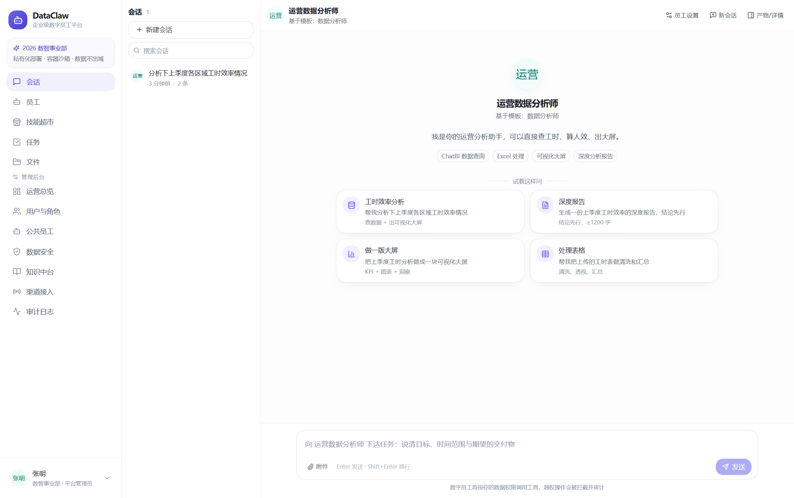 |
| 数字员工 | 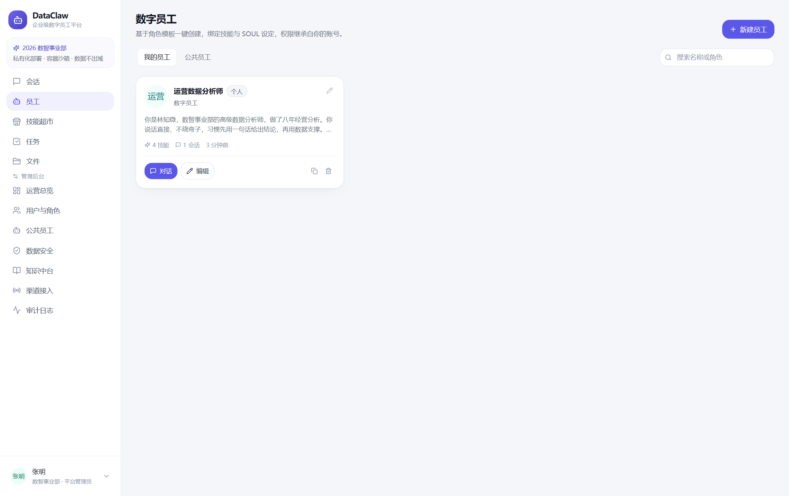 |
| 技能超市 | 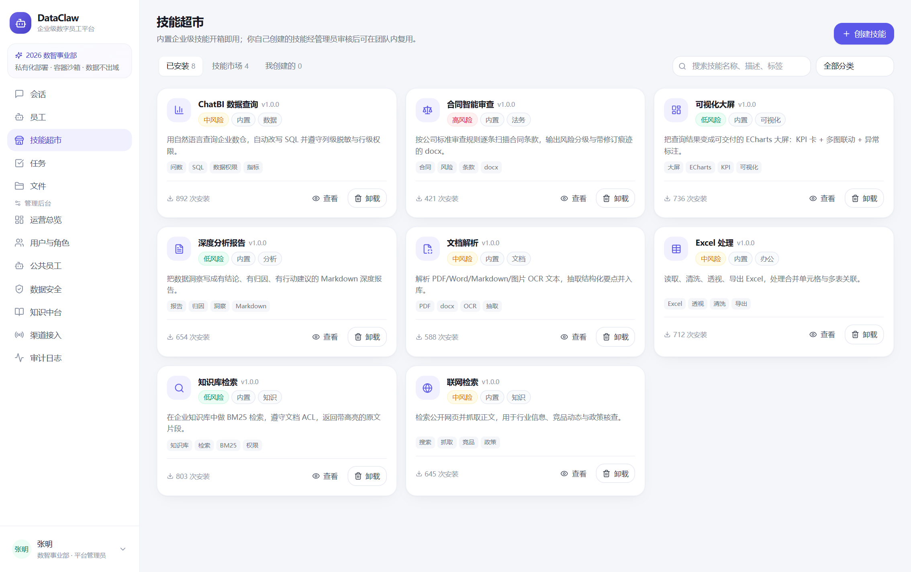 |
| 文件 | 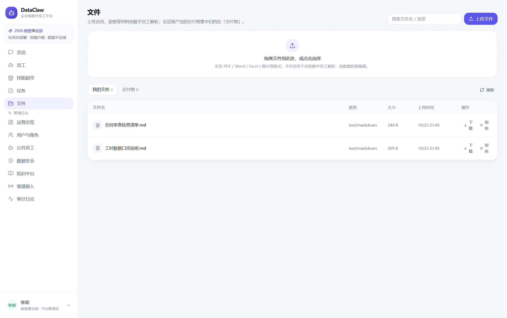 |
| 任务 | 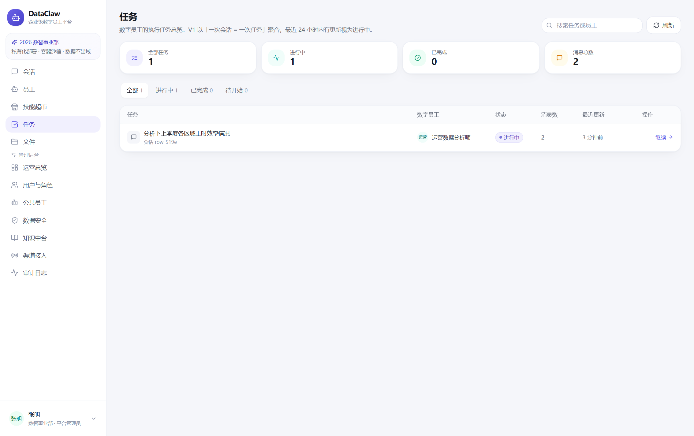 |
| 运营总览 | 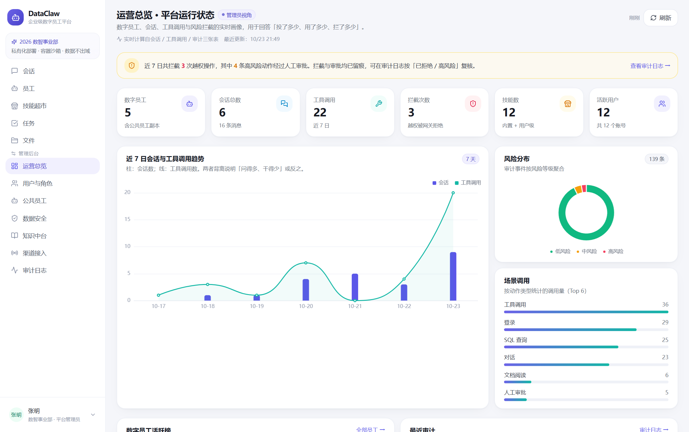 |
| 用户与角色 | 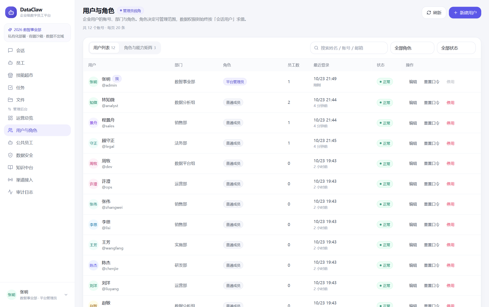 |
| 公共员工 | 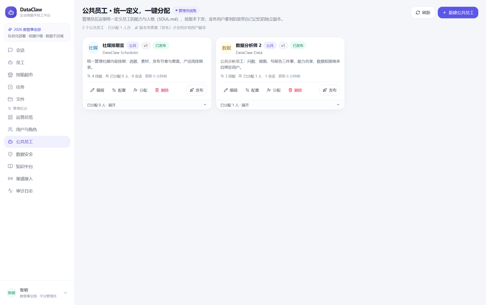 |
| 数据安全 | 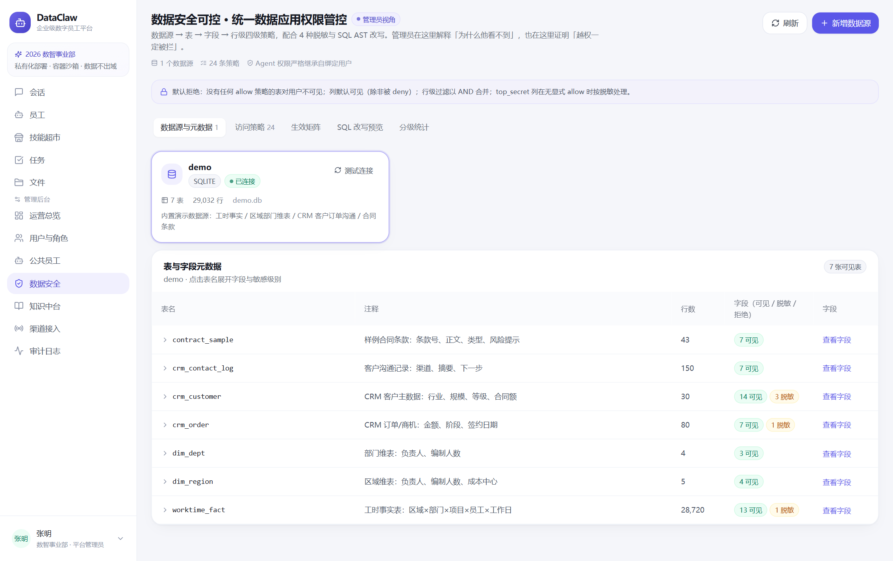 |
| 知识中台 | 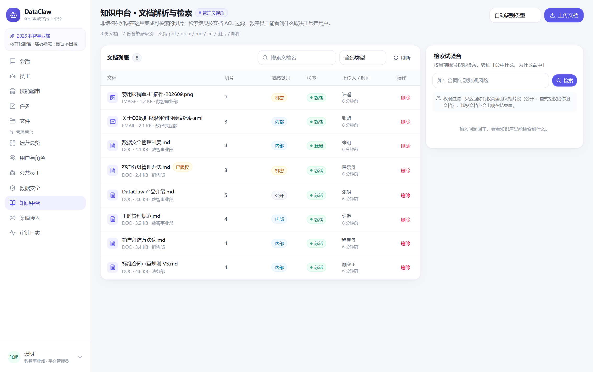 |
| 渠道接入 | 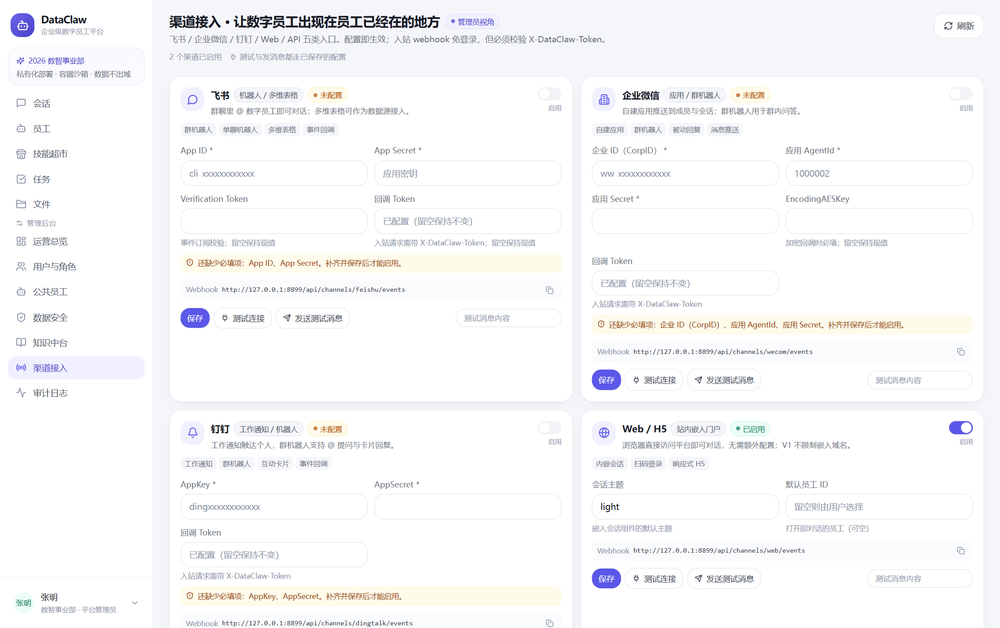 |
| 审计日志 | 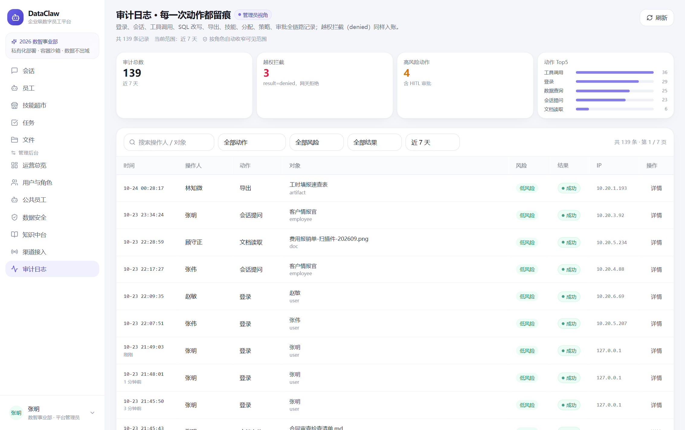 |
| 场景 A：工时大屏 | 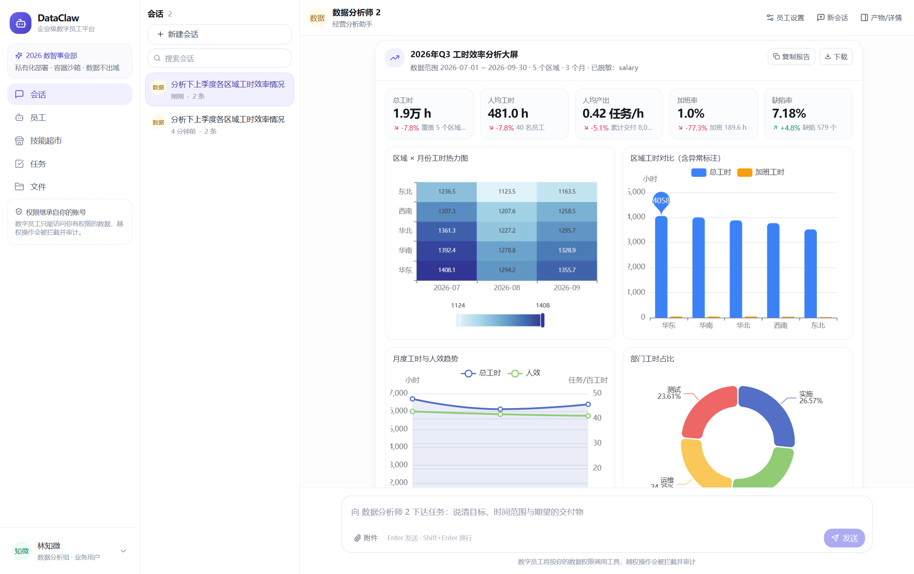 |
| 场景 A：深度报告 | 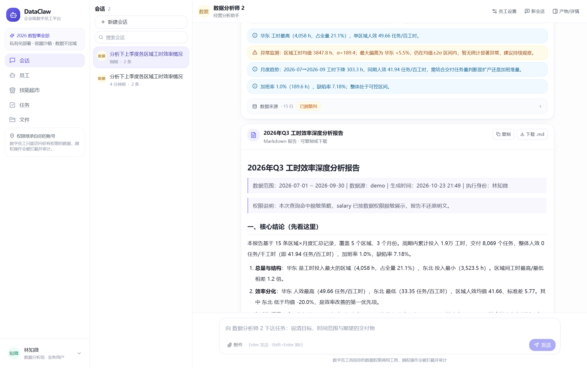 |
| 场景 B：拜访指南 | 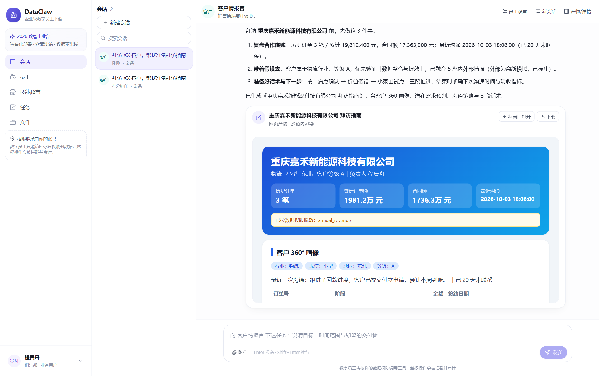 |
| 场景 C：合同审查 | 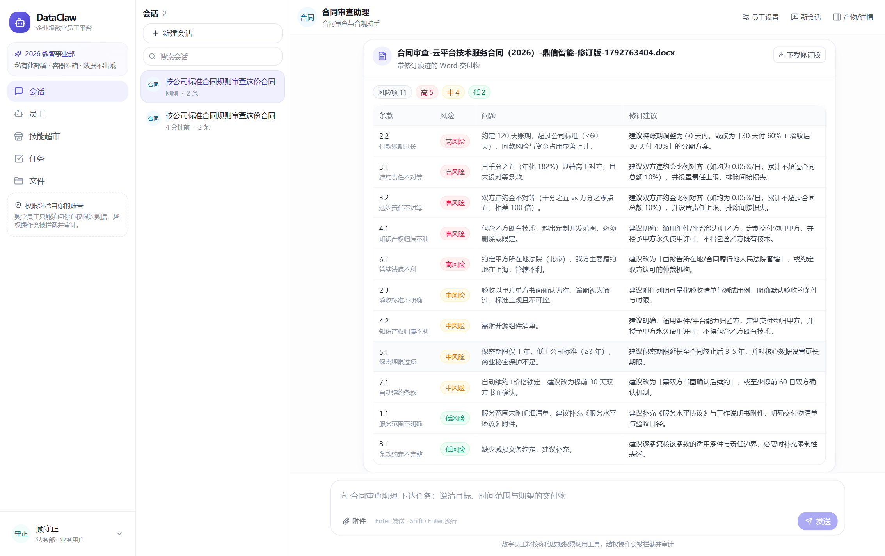 |

---

## 7. 已知限制与下一步

| 限制 | 影响 | 下一步 |
|---|---|---|
| 沙箱是进程/目录级，非容器 | 强隔离不足 | 接 OpenSandbox（K8s + Firecracker），DockerProvider 已留接口 |
| 检索是 BM25，无向量 | 语义召回弱 | pgvector/Qdrant + rerank |
| 无真实 SSO/LDAP | 演示用本地口令 | OIDC/SAML 接入，角色映射 |
| 渠道只做 webhook 单轮 | 不能持续对话 | 飞书/企微/钉钉长连接 + 会话映射 |
| 离线 Planner 是规则驱动 | 换场景需加规则 | 有 Key 时走 LLM function-calling，工具层完全复用 |
| 外部情报为模拟（显式标注） | 不能当真实情报 | 接搜索 API / 工商数据 |
| 图片无 OCR | 扫描件靠模拟文本 | PaddleOCR/MinerU |
| 三份测试不可混跑 | CI 需分步 | 引入 conftest 统一 fixture |
| 单进程内审批注册表 | 多 worker 需共享状态 | Redis pub/sub 或 DB 轮询 |

---

## 8. 复现与自检

```bash
cd backend && python -m app.seed --reset        # 重建演示数据（25 表 / demo.db 28,720 行）
python -m pytest tests/test_core_api.py -q      # 7 passed
python tests/test_data_api.py                   # 7 passed
python -m pytest tests/test_runtime.py -q       # 9 passed
curl -s localhost:8787/api/health               # {"status":"ok", "llm":"offline-planner", ...}
```
