# DataClaw 角色操作手册

> **版本**：V1.0 · 2026-10  
> **适用对象**：平台管理员、数据分析师、销售、法务，以及第一次接触本产品的演示/评审人员  
> **目标**：30 分钟内完成一次完整的“登录 → 配置 → 对话 → 交付 → 审计”闭环  
> **配套截图**：[`screenshots-manual/`](screenshots-manual/)（36 张，真实浏览器操作生成）  
> **单文件 HTML 版**：`docs/07-角色操作手册.html`（截图已内嵌，可直接发给同事或离线打开）

---

## 0. 一页纸速查卡

| 我想…… | 用哪个角色 | 一句话输入 / 操作 | 交付物 |
|---|---|---|---|
| 看平台运行得怎么样 | 管理员 | 左侧「运营总览」 | 员工/会话/工具调用/拦截/风险分布 |
| 给业务同事开通一个数字员工 | 管理员 | 「公共员工 → 分配」或用户自己「新建员工」 | 带独立记忆的员工副本 |
| 接入一个 Excel 做分析 | 管理员 | 「数据安全 → 新增数据源 → EXCEL」 | 自动建表、敏感列识别、可走 SQL 网关 |
| 看某个用户“到底能看到什么” | 管理员 | 「数据安全 → SQL 改写预览」切换身份 | 改写前后 SQL + 命中规则 + 脱敏结果 |
| 查上季度工时、出大屏和报告 | 数据分析师 | `帮我分析下上季度各区域工时效率情况` | 5 KPI + 4 图 + 深度报告 Markdown |
| 拜访前要一份客户指南 | 销售 | `我要拜访上海鼎信智能科技有限公司，帮我准备一份拜访指南` | 客户 360 + 需求预判 + 话术 |
| 审一份合同并出修订版 | 法务 | 上传合同 → `请按照公司标准合同规则审查这份合同` | 风险分级表 + 带修订痕迹的 docx |
| 查一次越权有没有被拦 | 管理员 | 「审计日志 → 结果 = 已拒绝」 | denied 记录、操作人、风险等级 |
| 让员工记住我的口径 | 任一角色 | `记住：我汇报默认用华东/华南两区对比，金额单位用万元` | 员工详情「记忆」新增一条偏好 |

**演示账号**（首次登录页可点击卡片自动填充）：

| 账号 | 口令 | 姓名 / 角色 | 关键权限特征 |
|---|---|---|---|
| `admin` | `admin123` | 张明 · 平台管理员 | 全部管理页；数据源级只读；可切换身份做权限预览 |
| `analyst` | `123456` | 林知微 · 数据分析师 | 工时表可读；`salary` 全掩码、`employee_name` 哈希；客户表拒绝 |
| `sales` | `123456` | 程景舟 · 销售经理 | 只看到自己名下客户/订单（行级过滤）；合同表拒绝 |
| `legal` | `123456` | 顾守正 · 法务顾问 | 合同条款可读；订单金额截断；工时表拒绝 |

> 演示数据均为模拟数据；生产部署时对接企业 SSO/LDAP，数字员工权限严格继承绑定用户。

---

## 1. 5 分钟把系统跑起来

### 1.1 启动

**方式 A：参考实现（推荐用于完整功能演示）**

```bat
scripts\run.cmd
```

脚本会自动挑选已安装依赖的 Python、构建前端，并在 **8787** 端口启动单端口服务。

**方式 B：Go 单二进制精简版（适合双击即用 / POC）**

```bat
scripts\lean.cmd
```

在 **8788** 端口启动，功能覆盖三条标杆场景与主要管控能力，界面更轻。本手册截图来自方式 A。

**方式 C：手动启动**

```bash
cd backend
pip install -r requirements.txt
cd ../frontend && pnpm install && pnpm build
cd ../backend
python -m uvicorn app.main:app --host 127.0.0.1 --port 8787
```

打开 <http://127.0.0.1:8787>。

### 1.2 登录


1. 在「账号 / 口令」输入演示账号，或点击下方「演示账号」卡片自动填充。
2. 点击「进入工作台」。
3. 登录后默认进入「会话」，左侧为功能导航；管理员会额外看到「管理后台」分组。

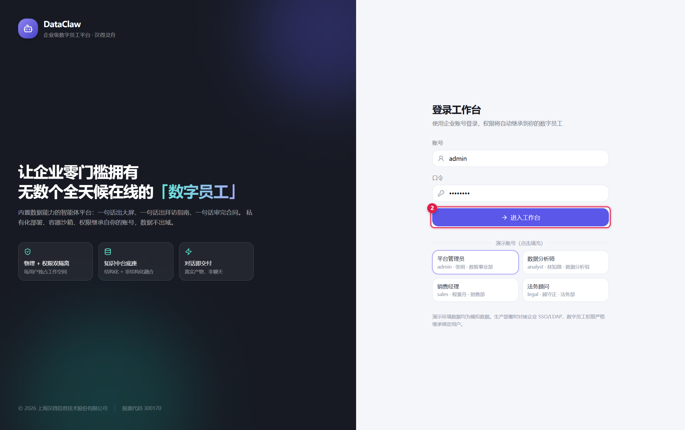

> 看不到「管理后台」是正常的：非管理员账号会被路由守卫限制在业务页面。

### 1.3 界面地图

| 区域 | 作用 |
|---|---|
| 左侧导航 | 会话 / 员工 / 技能超市 / 任务 / 文件；管理员多出运营总览、用户与角色、公共员工、数据安全、知识中台、渠道接入、审计日志 |
| 会话列表 | 按员工分组的历史会话；「新建会话」开新话题 |
| 对话区 | 输入任务；执行过程以「步骤时间线」展示，产物直接渲染在回答下方 |
| 底部输入区 | `Enter` 发送、`Shift+Enter` 换行；「附件」上传合同/表格 |
| 右上角 | 员工设置、新会话、产物/详情 |

---

## 2. 管理员：把平台配起来

管理员的目标不是“自己干活”，而是把 **人、员工、数据、技能、渠道、审计** 六件事配好，让业务用户开箱即用。

### 2.1 运营总览：先看“投了多少、用了多少、拦了多少”

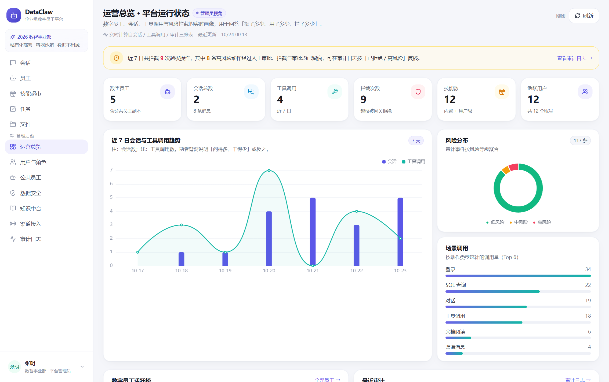

**步骤**

1. 左侧点击「运营总览」。
2. 顶部看 6 个核心指标：数字员工、会话总数、工具调用、拦截次数、技能数、活跃用户。
3. 中部看近 7 日会话/工具调用趋势与风险分布。
4. 右侧「场景调用」按动作类型看 Top 6（登录、对话、工具调用、SQL 查询、文档阅读、渠道消息）。

**预期结果**

- 指标来自真实数据表，不是静态图片。
- 拦截次数 > 0 说明数据权限网关正在工作；点击预警条可直接跳到审计日志。

### 2.2 用户与角色：先有账号，才有“权限继承”

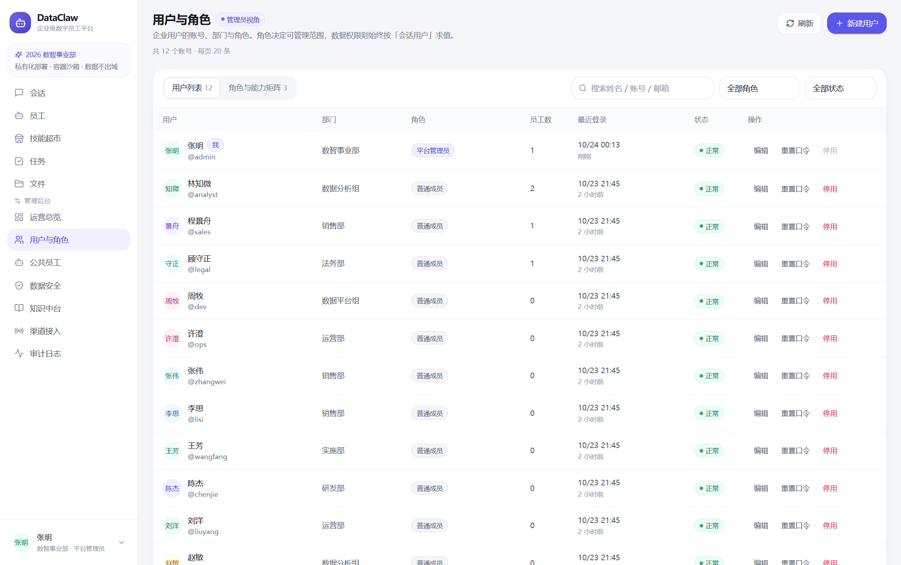

**步骤**

1. 左侧「用户与角色」。
2. 查看账号列表、角色（平台管理员 / 部门管理员 / 成员）、部门、状态、最近登录。
3. 新建账号时设置角色与部门；角色决定“兜底权限”，用户级策略优先于角色级策略。
4. 需要停用账号时，把状态改为禁用；禁用后无法登录，但其历史审计保留。

**要点**

- 数字员工不是独立权限主体：它执行任务时始终以 **会话用户** 的身份求值。
- 因此“给员工装了什么技能”决定“能调用哪些工具”，“登录的是谁”决定“能看到哪些数据”。

### 2.3 公共员工：统一定义、版本下发、一键分配

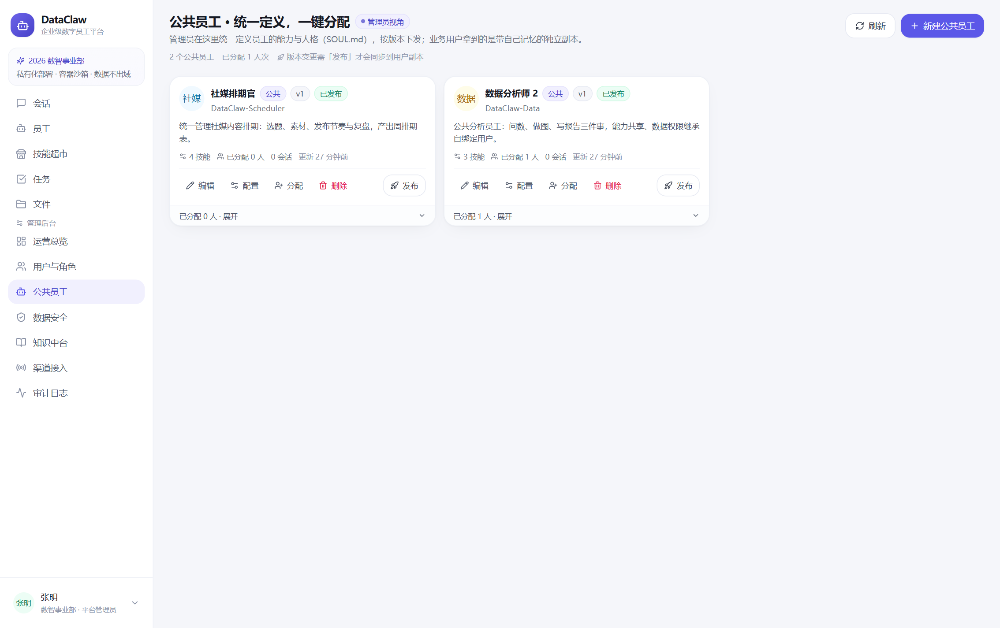

**步骤**

1. 左侧「公共员工」。
2. 查看公共员工的 SOUL、技能、版本、已分配人数。
3. 点击「新建公共员工」→ 填写名称、描述、SOUL.md、选择技能 → 创建。
4. 修改后点击「保存」：版本号 +1，但 **不会自动同步**；需要点击「发布变更」。
5. 点击「分配」→ 勾选业务用户 → 「确认分配」。

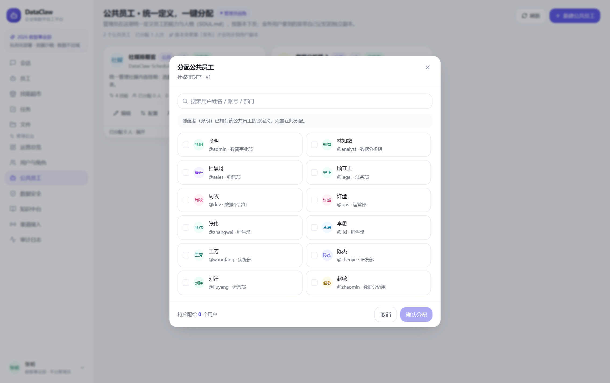

**预期结果**

- 每个被分配用户侧生成一个 **独立副本**（名称后缀「副本」），拥有独立会话与记忆。
- 重复分配是幂等的（`created=0, skipped=1`）。
- 发布后所有副本同步到新版本，但不会覆盖用户自己改过的名称。

**适用场景**

- 部门里有一套成熟的分析口径/审查规则，希望所有业务同事直接复用，而不是从 0 训练。
- 员工离职时，公共员工定义仍在平台，不会把能力带走。

### 2.4 数据安全：五层策略 + 四种脱敏 + SQL 改写

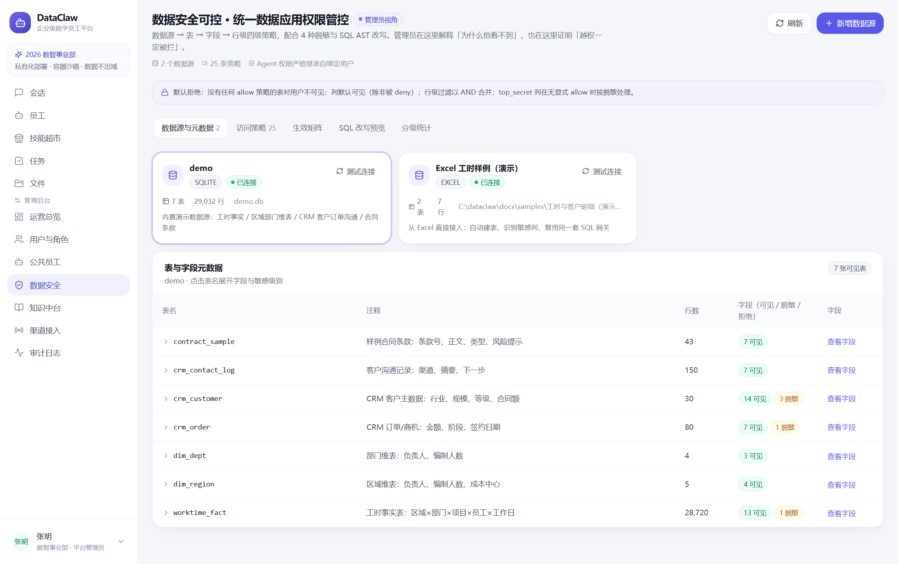

这里是企业最关心的页面：**不是“有没有权限”，而是“为什么他看不到 / 为什么他只能看到这些”。**

#### 2.4.1 接入数据源（含 Excel）

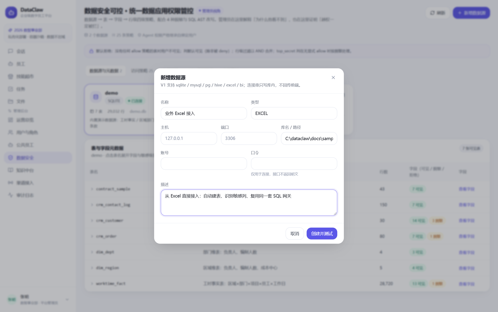

**步骤**

1. 「数据安全 → 数据源与元数据 → 新增数据源」。
2. 类型选 `EXCEL`，在「库名 / 路径」填 `.xlsx` 文件的绝对路径或相对仓库的路径。
3. 点击「创建并测试」。

**系统自动完成**

- 每个工作表导入为一张只读 SQLite 表；
- 首行作为表头，自动推断列类型；
- 按列名做轻量敏感识别（如「薪资/工资」→ secret，「身份证/银行卡」→ top_secret）；
- 为平台管理员自动加一条数据源级 allow 策略，业务用户仍需单独授权；
- 后续表/列/行级策略、SQL 改写、脱敏全部复用同一套网关。

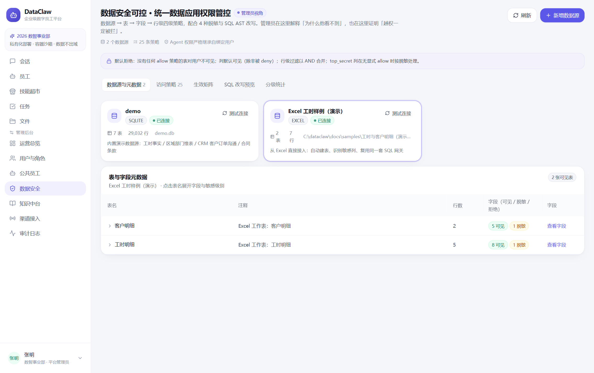

**示例文件**：[`samples/工时与客户明细（演示样例）.xlsx`](samples/工时与客户明细（演示样例）.xlsx)

> 限制：V1 支持 `.xlsx/.xlsm`；`.xls` 请先另存为 `.xlsx`。MySQL/PG/Hive 保存连接串但不内置驱动，生产环境需安装对应驱动。

#### 2.4.2 访问策略：用户/角色 × 数据源/表/列/行


**步骤**

1. 切到「访问策略」。
2. 点击「新建策略」，选择主体（用户或角色）、资源类型、资源、动作（allow/deny）、脱敏方式。
3. 列级策略可选 `mask / hash / replace / truncate`；行级策略填写 SQL 条件（如 `owner_id='u_sales'`）。
4. 保存后 **下一次求值即时生效**，无需重启。

**求值规则**

- 默认拒绝：没有任何 allow 策略的表对用户不可见。
- 同一资源上，**用户级策略优先于角色级策略**；同类型按 `priority` 大者优先。
- 脱敏在结果集返回前执行；`maskedColumns` 会标记在结果里。
- 行级过滤以 `AND` 合并到 `WHERE`（遇到 OR 语义会收紧，见已知边界）。

#### 2.4.3 SQL 改写预览：一眼解释“为什么”

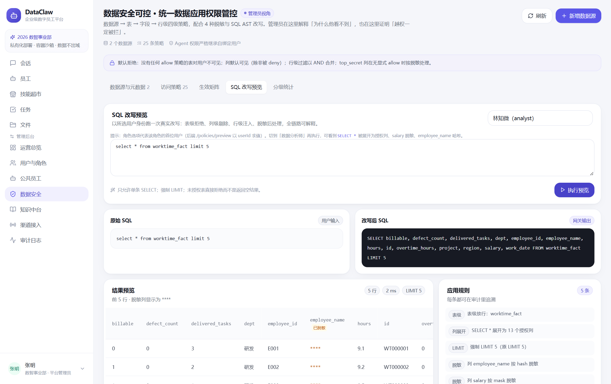

**步骤**

1. 切到「SQL 改写预览」。
2. 右上角身份选择「林知微（analyst）」。
3. 输入 `select * from worktime_fact limit 5`。
4. 点击「执行预览」。

**你会看到**

- 原始 SQL 与改写后 SQL 左右对照；
- `SELECT *` 被展开为授权列；
- 命中规则：表级放行、列展开、强制 LIMIT、`salary` mask、`employee_name` hash；
- 结果预览中 `salary` 显示为 `****`，`employee_name` 显示为哈希；
- 所有规则与结果可追溯到审计。

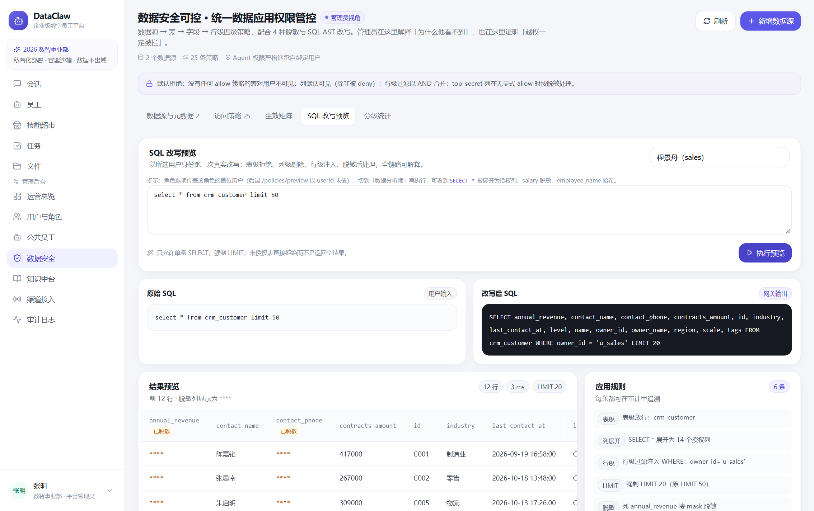

**行级过滤示例**

把身份切到「程景舟（sales）」，输入：

```sql
select * from crm_customer limit 50
```

改写后 SQL 自动追加：

```sql
WHERE owner_id = 'u_sales' LIMIT 20
```

结果只返回 12 行（他名下客户），`annual_revenue`、`contact_phone` 按策略脱敏。**用户无法通过改 SQL 绕过这条限制。**

#### 2.4.4 Excel 数据源也能走同一套网关

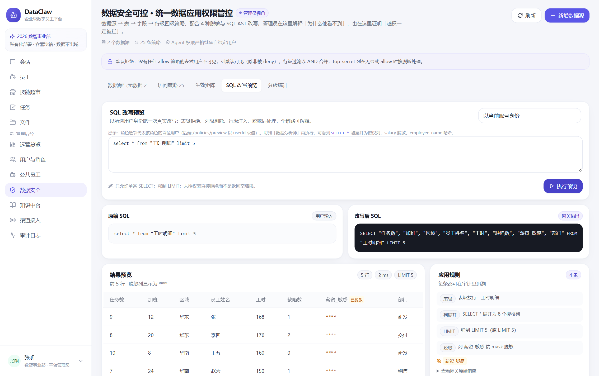

**步骤**

1. 在「数据源与元数据」选中「Excel 工时样例（演示）」。
2. 切到「SQL 改写预览」，身份保持「以当前账号身份」。
3. 输入 `select * from "工时明细" limit 5`（表名含中文时用双引号）。
4. 执行预览。

**结果**

- 网关对 Excel 导入表同样做表级放行、列展开、LIMIT、脱敏；
- `薪资_敏感` 自动按 secret 级别 mask 为 `****`；
- 可在「应用规则」里看到 4 条规则。

#### 2.4.5 生效矩阵与分级统计

- 「生效矩阵」：按用户查看每张表的可见性、脱敏列、行级过滤与命中策略，适合回答“他为什么看不到”。
- 「分级统计」：按 public/internal/secret/top_secret 统计列数，快速判断哪些表需要收紧。

### 2.5 知识中台：让数字员工引用企业自己的规则

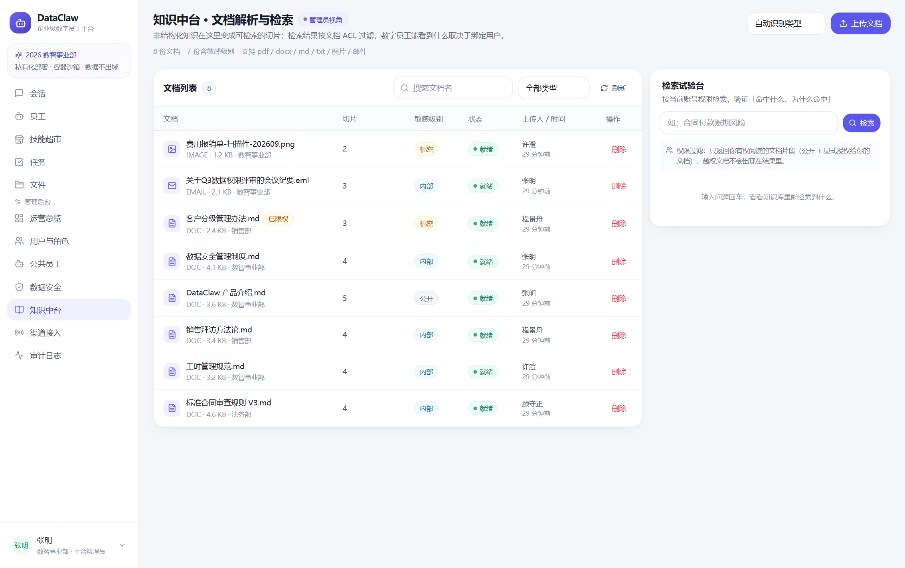

**步骤**

1. 左侧「知识中台」。
2. 点击「上传文档」，支持 PDF / DOCX / TXT / MD / CSV 等。
3. 系统解析、切片并建立 BM25 索引（遵守文档 ACL）。
4. 在右侧检索框输入问题，查看命中片段、出处与分数。

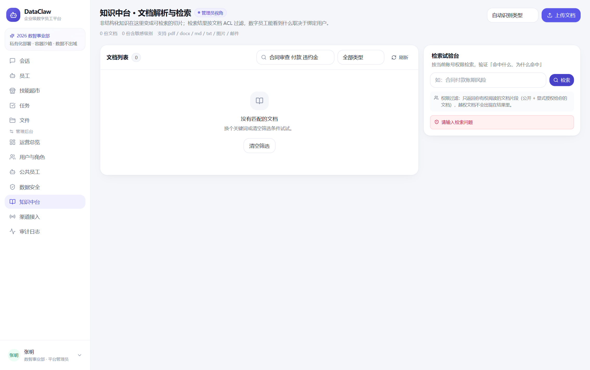

**建议上传**

- 《标准合同审查规则 V3》
- 《销售拜访方法论》
- 《工时填报与加班审批制度》
- 合同范本、投标模板、产品白皮书

> 检索是 BM25，不是向量检索；适合“关键词明确”的企业制度/规则。语义召回与 rerank 在 V2 路线。

### 2.6 渠道接入：飞书 / 企微 / 钉钉 / Web / API

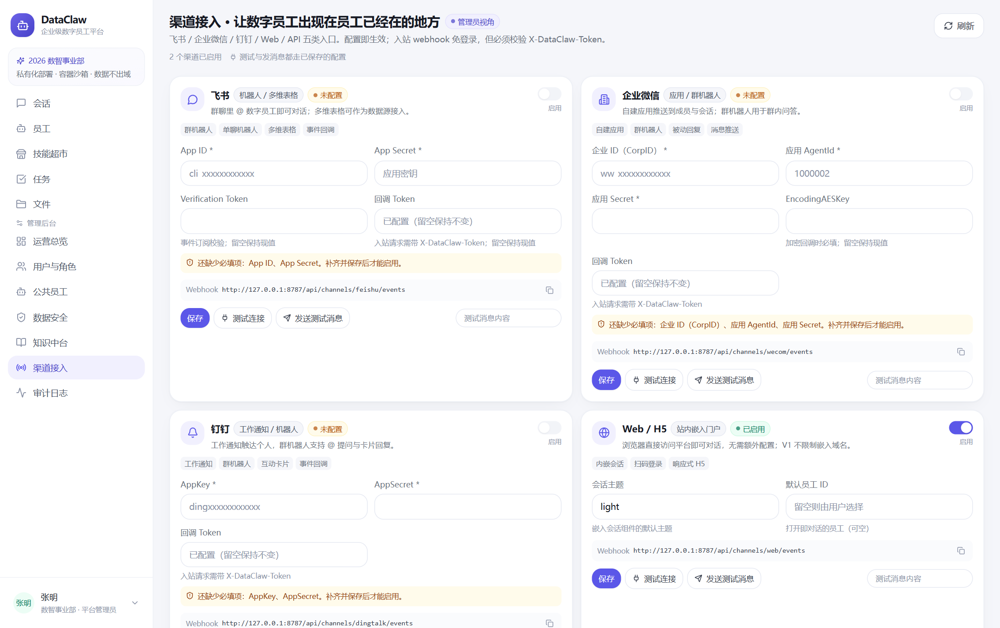

**步骤**

1. 左侧「渠道接入」。
2. 选择渠道，填写 App ID / Secret / Webhook 等必填项 → 「保存」。
3. 点击「测试连接」验证凭据。
4. 点击「发送测试消息」，走一次真实的入站回调，确认能收到回复。

**入站 webhook**

```http
POST /api/channels/{channel}/events
X-DataClaw-Token: <渠道 token>
Content-Type: application/json

{"text": "公司的合同审查规则是什么？"}
```

**预期结果**

- 返回 `reply` 与命中条数；消息入审计（`channel_inbound`）。
- V1 是 webhook 单轮问答；飞书/企微/钉钉长连接与多轮会话映射在 V2。

### 2.7 审计日志：每一次动作都留痕

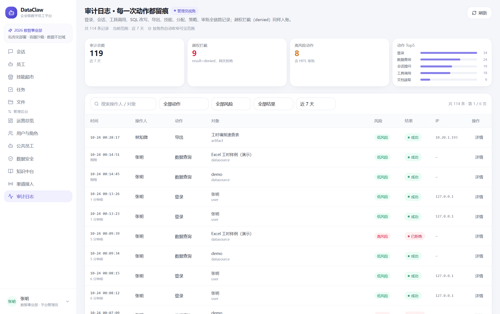

**步骤**

1. 左侧「审计日志」。
2. 按操作人/对象搜索，或按动作、风险、结果、时间范围筛选。
3. 把「结果」切到「已拒绝」，查看越权拦截。

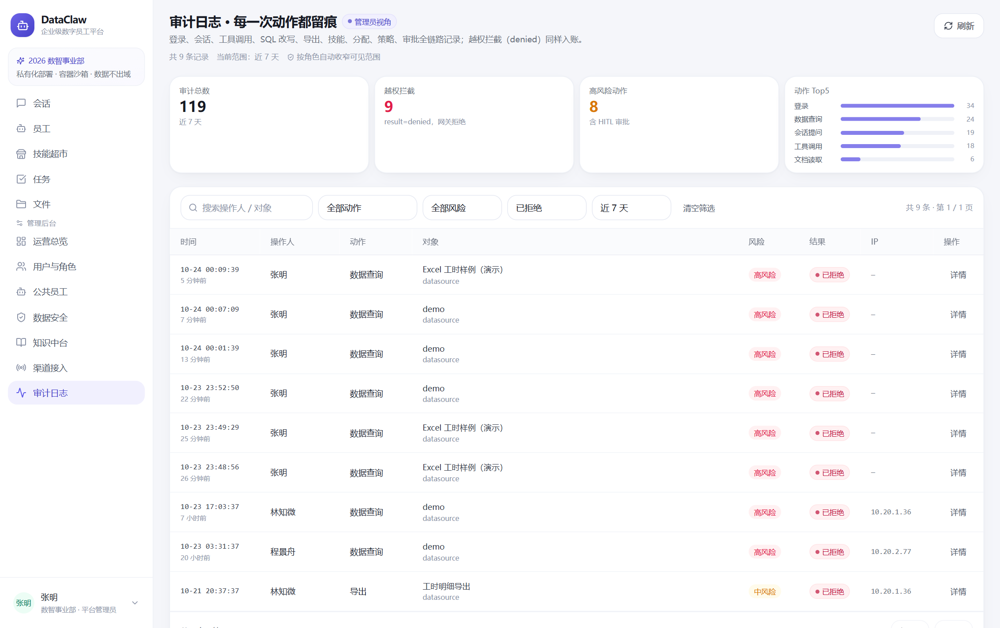

**你会看到**

- 登录、会话、工具调用、SQL 改写、导出、技能安装、公共员工分配、策略变更、HITL 审批全部入账；
- denied 记录包含操作人、对象、风险等级、IP、时间；
- 点击「详情」可看原始参数与拒绝原因。

**验收小技巧**

- 先让 analyst 查一次客户表，再回到审计筛选 denied，能直接讲清“越权一定被拦”。
- 导出 docx 的 HITL 审批也会出现在审计里（`hitl_approval`）。

### 2.8 技能超市：能力即权限


**步骤**

1. 左侧「技能超市」。
2. 「已安装 / 技能市场 / 我创建的」三个 Tab 切换。
3. 点击「查看」阅读 SKILL.md：能力边界、工具清单、安全扫描结果。
4. 点击「安装」把技能装到当前用户；到员工详情里再绑定到具体员工。

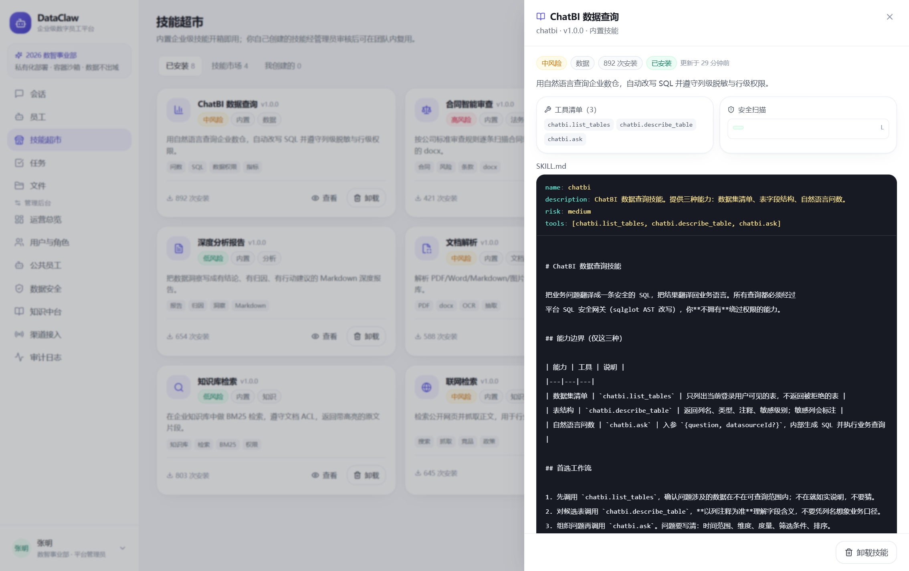

**关键机制**

- 技能 → 工具清单 → 员工装载；**未装载技能 = 运行时根本没有注册对应工具**，不是靠提示词约束。
- 用户自建技能提交后进入「待审核」，管理员审核通过后其他用户才能安装。
- 上传时做静态安全扫描（curl / rm -rf / eval / subprocess 等规则），风险等级与发现项会展示。

### 2.9 新建个人员工：从模板开始，改 SOUL 和技能

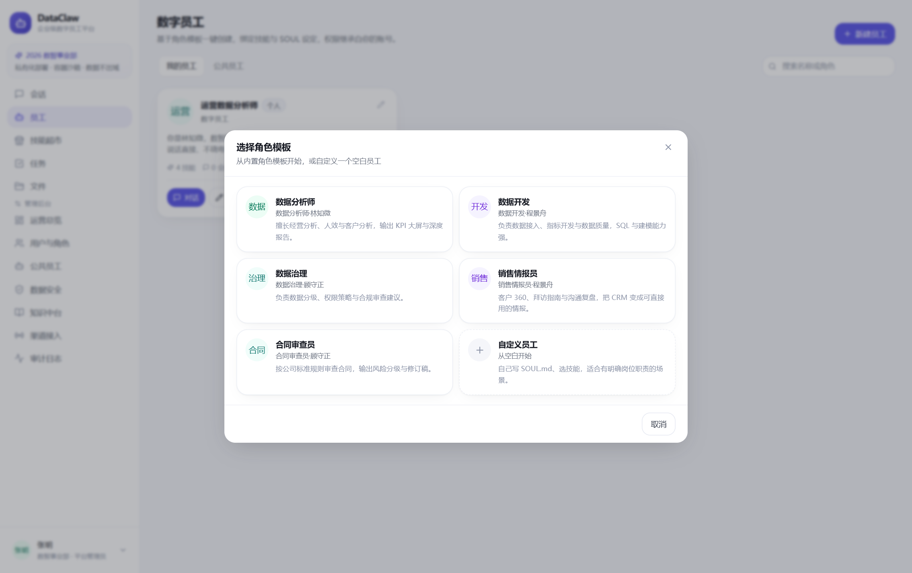

**步骤**

1. 左侧「员工 → 新建员工」。
2. 选择角色模板：数据分析师 / 数据开发 / 数据治理 / 销售情报员 / 合同审查员 / 自定义。
3. 填写名称、SOUL.md，勾选技能。
4. 创建后在员工详情里可继续改 SOUL、开关记忆、增删技能。

**建议**

- SOUL 写“职责边界 + 输出规范 + 禁止事项”，不要写成泛泛的人设。
- 技能宁少勿多：只装完成任务所需的工具，减少越权面。

---

## 3. 数据分析师：一句话出大屏 + 深度报告

### 3.1 进入员工

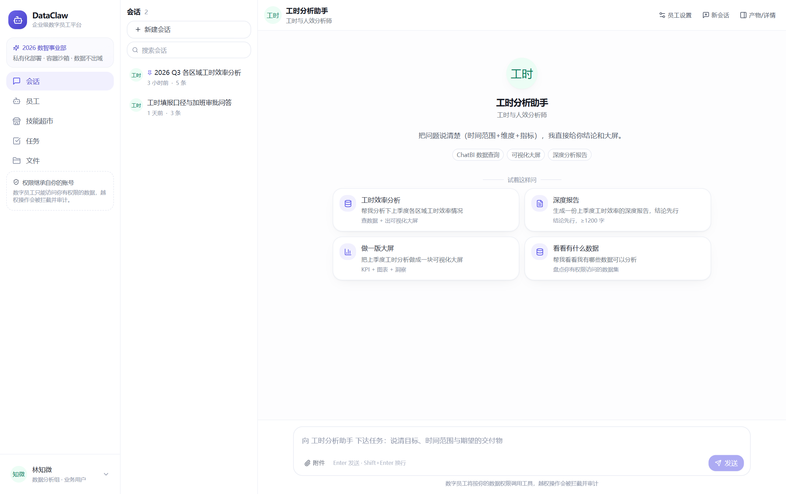

1. 用 `analyst / 123456` 登录。
2. 左侧「会话」，选择「工时分析助手」。
3. 输入框上方会显示该员工的已装技能与建议问法。

### 3.2 下达任务

输入并发送：

```text
帮我分析下上季度各区域工时效率情况
```

### 3.3 看执行过程

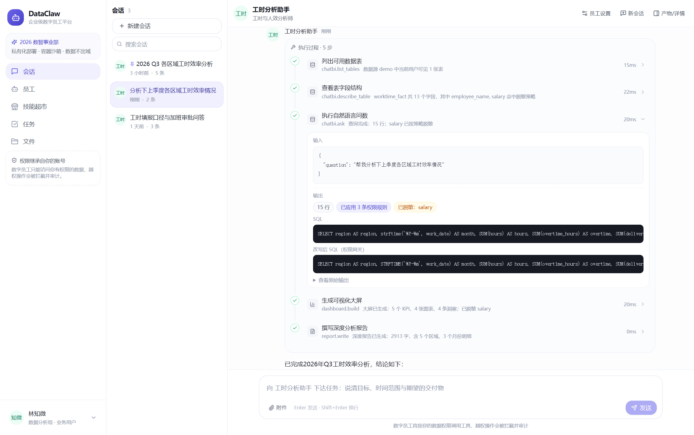

展开「执行过程」可以看到 5 步：

| 步骤 | 工具 | 说明 |
|---|---|---|
| 列出可用数据表 | `chatbi.list_tables` | 只列出当前用户可见的表 |
| 查看表字段结构 | `chatbi.describe_table` | 标出哪些列会命中脱敏策略 |
| 执行自然语言问数 | `chatbi.ask` | 真实执行 SQL，经过权限网关 |
| 生成可视化大屏 | `dashboard.build` | 只产出合法 ECharts option，数字来自真实结果 |
| 撰写深度分析报告 | `report.write` | 生成 Markdown 报告 |

点击「执行自然语言问数」可展开输入/输出、原始 SQL、改写后 SQL、命中规则与脱敏列。

**你应看到**

- 输出标记：`15 行`、`已应用 3 条权限规则`、`已脱敏: salary`；
- 改写后 SQL 由网关生成，不是模型自由发挥；
- 原始 SQL 中的 `salary` 在结果里显示为 `****`。

### 3.4 大屏

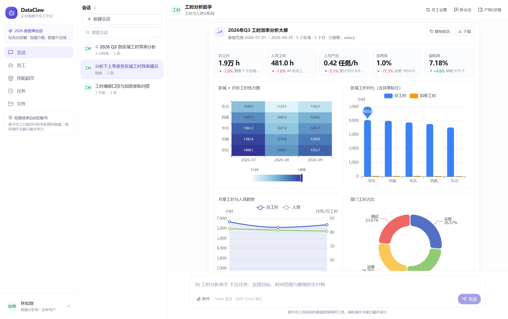

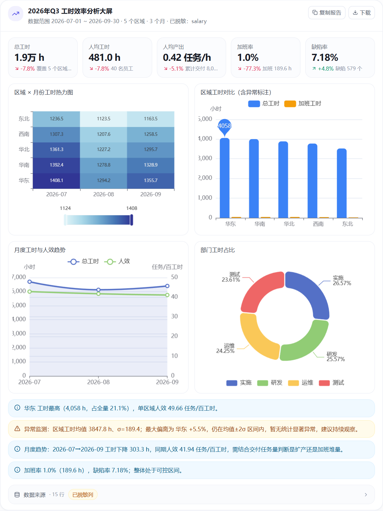

**5 个 KPI**：总工时、人均工时、人均产出、加班率、缺陷率。  
**4 张图**：区域 × 月份热力图、区域对比柱状图（含异常标注）、月度趋势折线、部门占比环形图。  
**4 条洞察**：最高/最低区域、异常监测、月度趋势、加班与质量。

支持：

- 「复制报告」：把摘要复制到剪贴板；
- 「下载」：下载大屏数据（Markdown/数据文件）；
- 图表可交互（悬浮查看数值）。

> 页面上的「已脱敏：salary」不是装饰：当前分析师看不到薪资原文，报告也不会还原。

### 3.5 深度报告

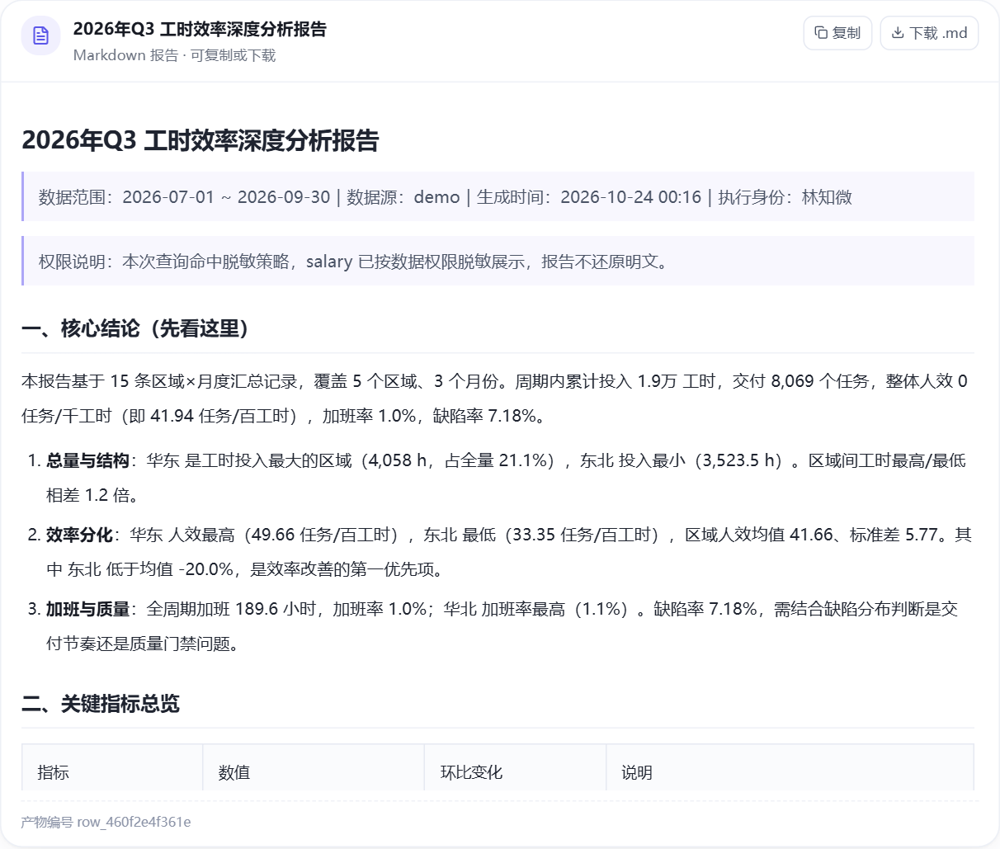

报告结构：

1. 核心结论（结论先行）
2. 关键指标总览
3. 区域/部门拆解
4. 异常与风险
5. 行动建议
6. 数据口径与权限说明

支持「复制」与「下载 .md」，可直接贴进周报/汇报材料。

### 3.6 教会即记住：自动记忆

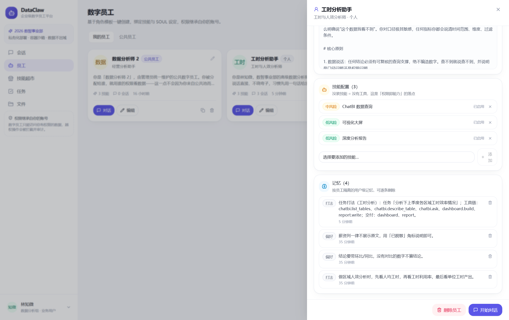

**方式一：显式告诉它**

```text
记住：我汇报默认用华东/华南两区对比，金额单位用万元
```

发送后打开「员工 → 工时分析助手 → 编辑」，在「记忆」里会新增一条「偏好」。

**方式二：成功完成任务后自动沉淀**

每成功跑完一个标杆场景，系统会写入一条「任务打法（工时分析）」记忆，记录工具链与交付物类型；同一场景只保留一条，避免记忆膨胀。

**管理**

- 记忆按员工隔离，可逐条删除；
- 员工详情里可关闭「记忆」开关；
- 记忆会进入下一轮系统提示词的「长期记忆」区块。

### 3.7 常见追问与建议

| 你想要 | 试试这样问 |
|---|---|
| 只看某区域 | `只看华东和华南，按部门拆一下工时和加班` |
| 看趋势 | `把近 6 个月的人效趋势画出来，标出异常月份` |
| 出汇报材料 | `生成一份上季度工时效率的深度报告，结论先行，≥1200 字` |
| 处理上传表格 | 上传 xlsx → `帮我把这张工时表做清洗和汇总，输出透视表` |
| 导出明细 | `把工时明细导出成 Excel` |

---

## 4. 销售：一句话出拜访指南

### 4.1 进入员工并提问

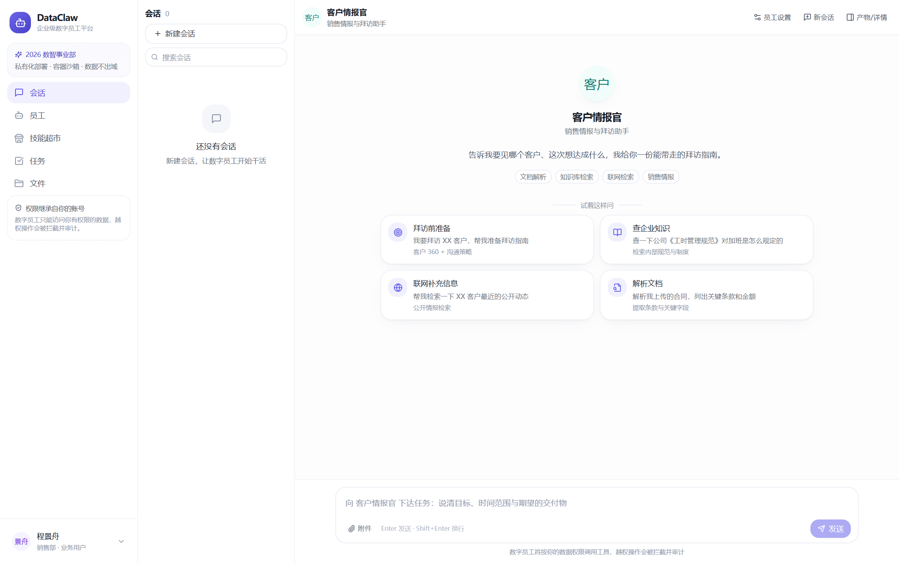

1. 用 `sales / 123456` 登录。
2. 选择「客户情报官」。
3. 输入：

```text
我要拜访上海鼎信智能科技有限公司，帮我准备一份拜访指南
```

### 4.2 看执行过程：4 步融合内外数据

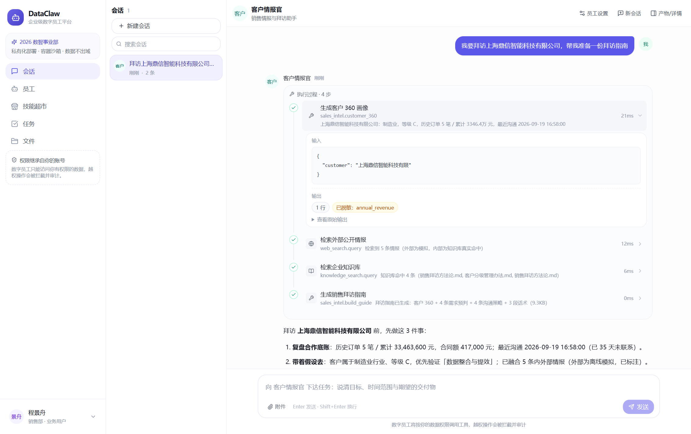

| 步骤 | 工具 | 说明 |
|---|---|---|
| 生成客户 360 | `sales_intel.customer_360` | 查 CRM；受行级权限限制，只返回自己名下客户 |
| 检索外部公开情报 | `web_search.query` | 演示环境为离线模拟，结果显式标注 |
| 检索企业知识库 | `knowledge_search.query` | 命中拜访方法论、客户分级办法等 |
| 生成拜访指南 | `sales_intel.build_guide` | 输出结构化 HTML 指南 |

**权限证据**

- 客户 360 输出显示 `1 行`、`已脱敏: annual_revenue`；
- 因为销售只有自己名下客户的行级权限，输入别家客户时系统会明确提示“不在你负责的客户列表”，并改用你名下的客户作为示例，而不是越权返回。

### 4.3 拜访指南

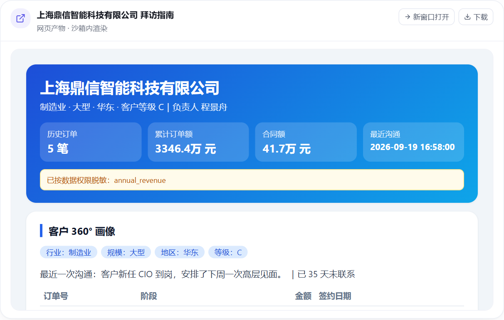

指南包含：

- **客户 360**：行业、规模、区域、等级、负责人、历史订单、累计订单额、合同额、最近沟通；
- **需求预判**：结合行业/规模/沟通记录给出假设；
- **沟通策略**：先确认痛点，再给价值假设，最后小范围试点；
- **话术要点**：开场、价值、下一步；
- **风险与注意事项**：长时间未联系、决策链变化等。

支持「新窗口打开」与「下载」。

### 4.4 销售常见任务

| 任务 | 输入 |
|---|---|
| 换一个客户 | `我要拜访北京远瞻信息技术有限公司，帮我准备拜访指南` |
| 查历史订单 | `查一下上海鼎信最近 5 笔订单和沟通记录` |
| 准备话术 | `针对制造业客户新任 CIO，给我 3 段开场话术` |
| 复盘 | `把这次拜访的下一步行动整理成清单` |

---

## 5. 法务：上传合同 → 风险分级 → HITL → 修订版 docx

### 5.1 上传合同

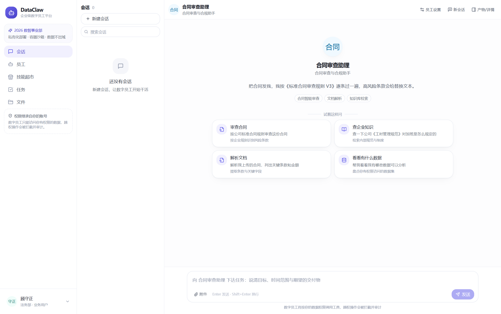

1. 用 `legal / 123456` 登录。
2. 选择「合同审查助理」。
3. 点击输入框下方「附件」，上传合同文件。
4. 支持 PDF / DOCX / TXT / MD；示例文件：[`samples/技术服务合同（演示样例）.docx`](samples/技术服务合同（演示样例）.docx)。

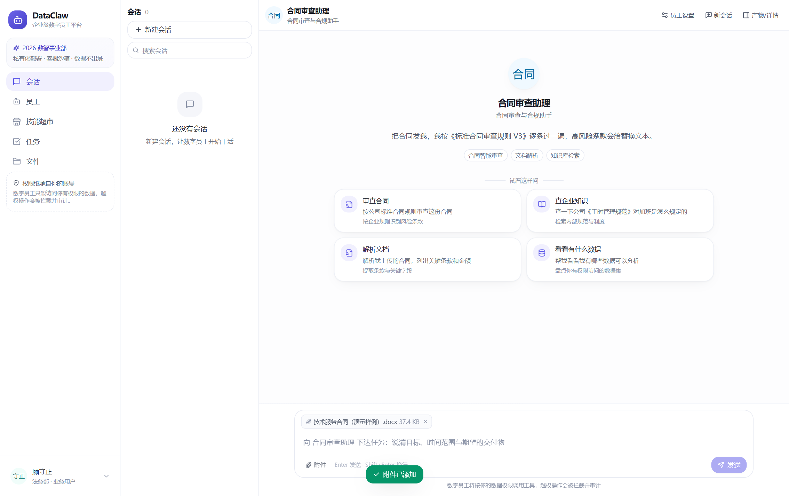

### 5.2 下达审查任务

```text
请按照公司标准合同规则审查这份合同
```

系统会自动识别为合同审查场景，依次执行：

1. 解析合同并读取条款（`doc_parse`）
2. 匹配企业审查规则库（`knowledge_search`）
3. 逐条比对并给出风险分级（`contract_review.analyze`）
4. 导出前触发 HITL 审批（`contract_review.export_docx`）

### 5.3 HITL：高风险动作必须人工确认

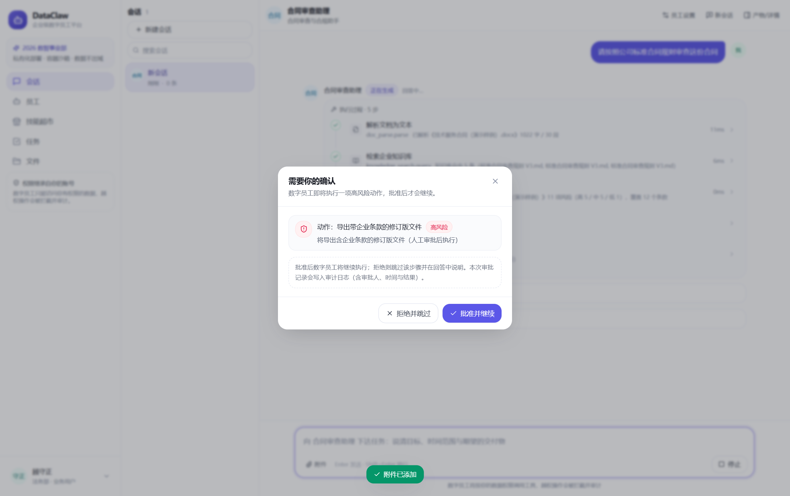

弹窗会说明：

- 动作：导出带企业条款的修订版文件；
- 风险：高风险；
- 选择「批准并继续」或「拒绝并跳过」；
- 审批记录（审批人、时间、结果）写入审计。

**预期结果**

- 批准：继续生成 docx，回答中给出风险统计与下载入口；
- 拒绝：跳过导出，只输出风险清单，回答中明确说明“导出未获审批”。

### 5.4 审查结果

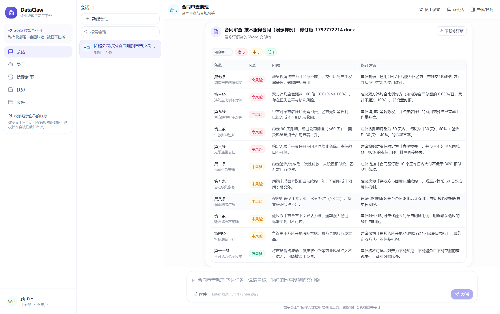

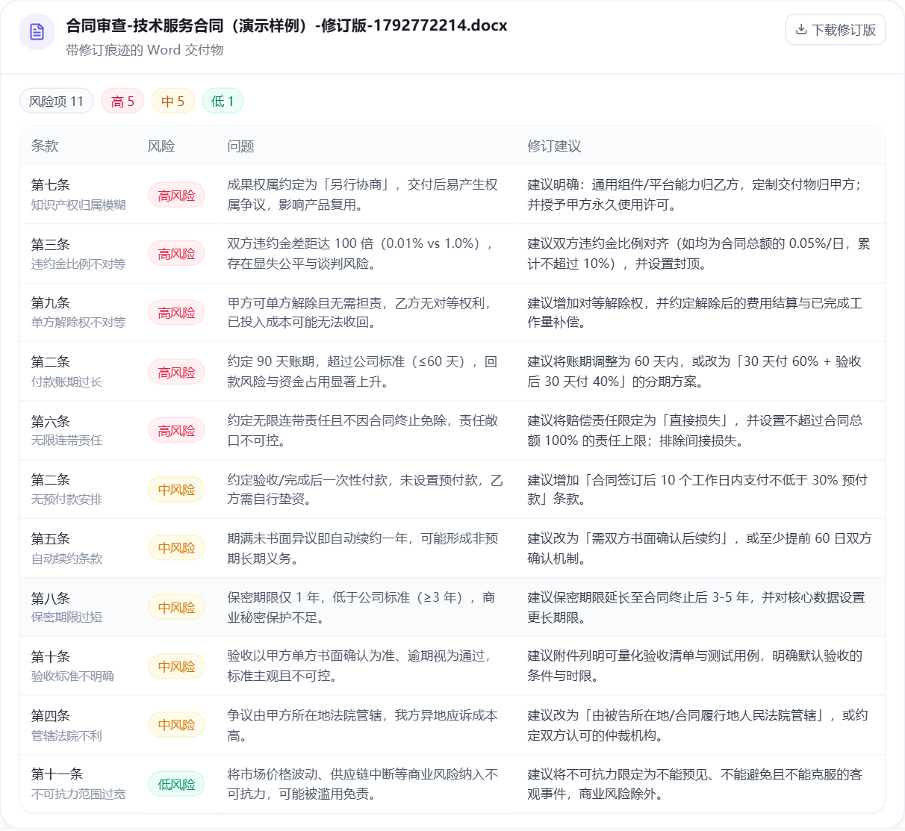

结果包含：

- 风险项总数与高/中/低分布；
- 逐条「条款 / 风险 / 问题 / 修订建议」；
- 条款类别评估（付款、违约、管辖、保密、知识产权、验收等）；
- 「下载修订版」按钮。

**修订版 docx**

- 使用 OOXML 的 `w:ins` / `w:del` 记录修订痕迹；
- 可直接用 Microsoft Word / WPS 打开；
- 文件保存在 `data/artifacts/`，下载走鉴权接口并写审计。

### 5.5 法务常见任务

| 任务 | 输入 |
|---|---|
| 只看高风险 | `只列出高风险条款，并给出替换文本` |
| 对比标准规则 | `逐条说明依据《标准合同审查规则 V3》的哪一条` |
| 改完再导出 | 在对话里说 `把付款账期改为 60 天后再导出` |
| 批量审查 | 逐份上传；V1 不做批量队列 |

> 扫描件/图片合同需要 OCR；V1 未内置 OCR，扫描件请先转成可复制文本的 PDF/DOCX。

---

## 6. 普通员工：创建并使用自己的数字员工

### 6.1 从模板创建

1. 左侧「员工 → 新建员工」。
2. 选择模板 → 填名称 → 改 SOUL → 选技能 → 创建。
3. 在员工详情里可继续：
   - 编辑 SOUL；
   - 开关「记忆」；
   - 添加/移除技能（未装技能 = 没有对应工具）；
   - 查看会话数与工具调用统计；
   - 删除员工。

### 6.2 技能安装与绑定

1. 「技能超市 → 技能市场」找到技能 → 「安装」。
2. 回到「员工 → 编辑 → 技能配置」→ 选择技能 → 「添加」。
3. 需要移除时点技能右侧的「×」；运行时立即不再注册该工具。

### 6.3 会话与产物

- 每次对话都会生成会话；左侧列表按更新时间排序。
- 产物（大屏/报告/HTML/docx）直接渲染在回答下方，可在右上角「产物/详情」集中查看。
- 「文件」页管理上传的附件；「任务」页查看任务与执行记录。

### 6.4 公共员工副本

- 管理员分配后，你的「员工 → 我的员工」会出现带「公共」标记的副本。
- 副本可以改名称、SOUL、技能、记忆；不会影响其他同事。
- 管理员发布新版本时，副本会同步能力定义，但保留你的个性化修改。

---

## 7. 数据安全怎么验收（评审/审计视角）

### 7.1 五层策略

| 层级 | 例子 | 作用 |
|---|---|---|
| 数据源级 | `ds_demo` allow | 控制整个数据源可见性 |
| 表级 | `worktime_fact` allow / `crm_customer` deny | 控制表是否可见 |
| 列级 | `salary` mask / `employee_name` hash | 控制列是否返回、如何脱敏 |
| 行级 | `owner_id='u_sales'` | 控制返回哪些行 |
| 指标级 | 指标定义引用 | 控制指标口径与可见性 |

### 7.2 四种脱敏

| 方式 | 效果 | 典型场景 |
|---|---|---|
| `mask` | 保留指定位数，其余替换为 `*` | 薪资、手机号 |
| `hash` | SHA-256 截断，保留关联能力 | 员工姓名、证件号 |
| `replace` | 替换为固定值/占位符 | 测试环境、脱敏导出 |
| `truncate` | 截断到指定位数 | 金额、合同额 |

### 7.3 三条“可验证”的证据链

1. **SQL 改写预览**：同一句 SQL 在不同身份下改写结果不同（截图 11 / 11b / 12）。
2. **审计日志**：denied 记录包含原因、操作人、对象、风险等级（截图 17）。
3. **HITL 审批**：导出修订版前必须人工确认，审批结果入审计（截图 34）。

### 7.4 隔离边界（V1 真实状态）

| 边界 | V1 实现 | 生产建议 |
|---|---|---|
| 用户工作空间 | 每员工独立目录 + 路径穿越防护 + 50MB 配额 | Docker/OpenSandbox，每会话一容器 |
| 身份 | 本地账号 + JWT | OIDC/SAML/LDAP 对接企业 SSO |
| 审批状态 | 单进程内存 | Redis pub/sub 或 DB 轮询 |
| 检索 | BM25 | pgvector/Qdrant + rerank |
| 渠道 | webhook 单轮 | 飞书/企微/钉钉长连接与多轮映射 |
| 外部情报 | 离线模拟（显式标注） | 搜索 API / 工商数据 |

> 这些是 **部署级 V2 边界**，不影响三条标杆场景与权限/审计主线的验收。

---

## 8. 常见问题（FAQ）

### 8.1 登录失败 / 401

- 确认账号口令（`admin/admin123`，其余 `123456`）；
- 确认后端已启动：`curl http://127.0.0.1:8787/api/health`；
- 清除浏览器 Cookie 后重试。

### 8.2 员工说“没有工具 / 能力不足”

- 该员工没有装载对应技能。到「员工 → 编辑 → 技能配置」添加；
- 或到「技能超市」先安装技能，再绑定到员工。

### 8.3 查询被拒绝 / 看不到表

- 默认拒绝是设计行为；到「数据安全 → 生效矩阵」看该用户的可见表；
- 需要授权时新建表级/列级/行级 allow 策略；
- 在「SQL 改写预览」切换该用户身份，能直接看到拒绝原因。

### 8.4 大屏空白 / 图表不显示

- 等待 1–2 秒让 ECharts 渲染；
- 确认浏览器不是极旧版本；
- 刷新页面；产物数据在服务端，不会丢。

### 8.5 docx 下载失败

- 下载接口需要登录态；不要直接在新标签页打开无 token 的 URL；
- 确认 `data/artifacts/` 有写权限；
- 审批被拒绝时不会生成 docx，只会输出风险清单。

### 8.6 Excel 接入失败

- 只支持 `.xlsx/.xlsm`；`.xls` 先另存为 `.xlsx`；
- 首行必须是表头，且至少有一行数据；
- 表名含中文时，SQL 里用双引号：`select * from "工时明细"`；
- 新数据源默认只有管理员可见，业务用户需要在「访问策略」里显式 allow。

### 8.7 端口被占用

```bat
netstat -ano | findstr :8787
taskkill /PID <PID> /F
```

或换端口启动：

```bash
python -m uvicorn app.main:app --host 127.0.0.1 --port 8789
```

### 8.8 重置演示数据

```bash
cd backend
python -m app.seed --reset
```

会重建 `app.db` / `demo.db` 与种子数据；已上传文件与产物目录按需保留/清理。

### 8.9 没有 LLM Key 能用吗？

能。默认使用「离线确定性 Planner」，三条场景会真实执行工具链（真查 SQL、真算图表、真生成 docx）。  
接入真实模型：

```bash
set DATACLAW_LLM_API_KEY=sk-...
set DATACLAW_LLM_BASE_URL=https://api.openai.com/v1
set DATACLAW_LLM_MODEL=gpt-4o-mini
```

有 Key 时走 LLM function-calling，工具层完全复用；LLM 故障会自动降级到离线 Planner。

---

## 9. 与 PDF 的能力对照

> 对照《DataClaw_V1.0.pdf》逐页检查。状态说明：✅ 已实现并可演示；🟡 已实现但有 V1 边界；⛔ 未实现（V2 路线）。

| PDF 能力 | 状态 | 本仓库落点 / 证据 |
|---|---|---|
| 数字员工：模板、SOUL、技能、记忆 | ✅ | 员工/模板/技能绑定；截图 20 / 26 |
| 公共员工：统一定义、版本、一键分配、用户级记忆 | ✅ | 公共员工页；截图 05 / 06；分配幂等测试 |
| 技能超市：内置技能、用户级技能、隔离、审核、静态扫描 | ✅ | 12 个 SKILL.md；截图 18 / 19 |
| 技能“自动创建” | ⛔ | 当前支持“对话记忆自动沉淀”（截图 26）与手动创建技能；从会话自动生成 SKILL.md 在 V2 |
| 三条标杆场景：工时/销售/合同 | ✅ | 截图 21–36；验收 26/26 |
| 工时：多源接入、大屏、报告 | ✅ | SQLite + Excel；5 KPI / 4 图 / 深度报告 |
| 销售：CRM + 外部 + 知识库 + 指南 | 🟡 | 全链路可跑；外部情报为离线模拟并显式标注 |
| 合同：PDF/Word 解析、规则比对、风险分级、修订版 docx | 🟡 | PDF/DOCX/TXT 真实解析；扫描件 OCR 未内置 |
| 数据安全：数据源/表/列/行/指标五层 | ✅ | 24 条种子策略 + 新建策略；截图 10 / 11 / 11b |
| 四种脱敏：mask/hash/replace/truncate | ✅ | SQL 网关结果集脱敏 |
| 敏感识别与分级 | ✅ | 列级 public/internal/secret/top_secret；Excel 自动识别 |
| 权限继承：Agent 严格继承绑定用户 | ✅ | 一切以会话用户求值；身份切换预览 |
| HITL：高风险动作人工审批 | ✅ | 导出 docx 前挂起；截图 34；审计 `hitl_approval` |
| 全链路审计：登录/会话/工具/SQL/导出/技能/分配/策略/审批 | ✅ | 审计页；截图 16 / 17 |
| 私有化部署 | ✅ | 单机单端口 / Go 单二进制 |
| 容器沙箱隔离 | 🟡 | 每员工独立目录 + 配额 + 路径防护；DockerProvider 接口预留 |
| 企业 SSO/LDAP | ⛔ | 本地账号 + JWT；OIDC/SAML 在 V2 |
| IM 集成：飞书/企微/钉钉 | 🟡 | 渠道配置 + 连通测试 + webhook 单轮；长连接在 V2 |
| 知识中台：结构化 + 非结构化 | 🟡 | 文档解析 + BM25 检索 + ACL；向量检索在 V2 |
| 多 Agent 协作/复杂编排 | ⛔ | 当前单员工工具链；公共员工解决“能力复用”，不做多 Agent 编排 |
| 统一算力调度/结算、多租户计费 | ⛔ | 单机原型；生产需调度与计费模块 |

**结论**：PDF 的核心产品形态——三条标杆场景、企业级权限/审计/HITL、公共员工与技能超市——已全部可运行、可验收；标注 🟡/⛔ 的是部署级与生态级能力，已在 `docs/03` §12 给出演进路径。

---

## 10. 附录

### 10.1 技术栈与目录

```
backend/app/{api,services,runtime,seed,core}   FastAPI + SQLAlchemy + Agent 运行时
frontend/src/{pages,components,lib}            React 18 + Vite + Tailwind + ECharts
lean/                                          Go 单二进制精简实现
docs/                                          PRD / 调研 / 架构 / 验收 / 手册
scripts/                                       run / dev / seed / test / lean
data/                                          app.db · demo.db · uploads · artifacts · workspaces
```

### 10.2 测试与验收命令

```bash
# 后端三套测试（独立进程 + 临时数据目录）
python -m pytest tests/test_core_api.py -q        # 7
python -m pytest tests/test_runtime.py -q         # 9
python tests/test_data_api.py                     # 8（含 Excel 数据源）

# 对运行中的实例做 26 项黑盒验收
python tools/acceptance.py --base http://127.0.0.1:8787
```

### 10.3 截图重生成

```bash
# 需先启动 8787，并安装 Chrome + tools/node_modules
cd tools
node manual-admin.mjs     # 管理员 01–20
node manual-roles.mjs     # 分析师/销售/法务 21–36
node manual-extra.mjs     # 行级过滤、自动记忆
```

截图输出到 `docs/screenshots-manual/`，视口 1512×950，deviceScaleFactor 1.5。

### 10.4 示例文件

| 文件 | 用途 |
|---|---|
| [`samples/技术服务合同（演示样例）.docx`](samples/技术服务合同（演示样例）.docx) | 法务场景上传；含付款、违约、管辖、保密、知识产权等风险条款 |
| [`samples/工时与客户明细（演示样例）.xlsx`](samples/工时与客户明细（演示样例）.xlsx) | Excel 数据源接入；2 个工作表，含敏感列 |

### 10.5 截图索引

| # | 截图 | 说明 |
|---|---|---|
| 01 | [登录页](screenshots-manual/01-login.png) | 账号口令与演示账号卡片 |
| 02 | [登录页标注](screenshots-manual/02-login-annotated.png) | 演示账号填充 + 进入工作台 |
| 03 | [运营总览](screenshots-manual/03-admin-overview.png) | 6 指标、趋势、风险分布、场景调用 |
| 04 | [用户与角色](screenshots-manual/04-admin-users.png) | 账号、角色、部门、状态 |
| 05 | [公共员工](screenshots-manual/05-admin-public-agents.png) | SOUL、技能、版本、分配 |
| 06 | [分配公共员工](screenshots-manual/06-admin-public-agent-assign.png) | 多选用户、确认分配 |
| 07 | [数据源](screenshots-manual/07-admin-datasources.png) | demo + Excel 数据源、表元数据 |
| 08 | [新增数据源](screenshots-manual/08-admin-datasource-modal.png) | 选择 EXCEL、填写路径 |
| 09 | [Excel 元数据](screenshots-manual/09-admin-excel-metadata.png) | 自动建表、敏感列 |
| 10 | [访问策略](screenshots-manual/10-admin-policies.png) | 用户/角色 × 五层资源 |
| 11 | [SQL 改写预览-分析师](screenshots-manual/11-admin-sql-preview.png) | `SELECT *` 展开、salary mask、name hash |
| 11b | [SQL 改写预览-销售](screenshots-manual/11b-admin-sql-rowfilter-sales.png) | 行级注入 `owner_id='u_sales'`、12 行 |
| 12 | [Excel SQL 预览](screenshots-manual/12-admin-excel-preview.png) | Excel 表走同一套网关、自动脱敏 |
| 13 | [知识中台](screenshots-manual/13-admin-knowledge.png) | 文档列表、解析状态 |
| 14 | [知识检索](screenshots-manual/14-admin-knowledge-search.png) | 片段、出处、分数 |
| 15 | [渠道接入](screenshots-manual/15-admin-channels.png) | 飞书/企微/钉钉/Web/API |
| 16 | [审计日志](screenshots-manual/16-admin-audit.png) | 全链路动作 |
| 17 | [审计-已拒绝](screenshots-manual/17-admin-audit-denied.png) | denied 记录与原因 |
| 18 | [技能超市](screenshots-manual/18-skills-market.png) | 已安装/市场/我创建的 |
| 19 | [技能详情](screenshots-manual/19-skill-detail.png) | SKILL.md、工具清单、安全扫描 |
| 20 | [新建员工](screenshots-manual/20-new-employee.png) | 6 个角色模板 |
| 21 | [分析师会话](screenshots-manual/21-analyst-chat-empty.png) | 空态与建议问法 |
| 22 | [分析师回答](screenshots-manual/22-analyst-answer.png) | 大屏开始渲染 |
| 23 | [大屏全貌](screenshots-manual/23-analyst-dashboard.png) | 5 KPI / 4 图 / 4 洞察 |
| 24 | [深度报告](screenshots-manual/24-analyst-report.png) | 结论先行的 Markdown |
| 25 | [执行步骤](screenshots-manual/25-analyst-steps.png) | 5 步工具链、SQL 改写、脱敏 |
| 26 | [员工记忆](screenshots-manual/26-analyst-memory.png) | 自动沉淀的「任务打法」 |
| 28 | [销售会话](screenshots-manual/28-sales-chat-empty.png) | 销售员工空态 |
| 29 | [销售回答](screenshots-manual/29-sales-answer.png) | 指南生成 |
| 30 | [拜访指南](screenshots-manual/30-sales-guide.png) | 客户 360 + 需求 + 话术 |
| 31 | [销售行级权限](screenshots-manual/31-sales-row-filter.png) | 客户 360 仅 1 行、年营收脱敏 |
| 32 | [法务会话](screenshots-manual/32-legal-chat-empty.png) | 合同审查员工空态 |
| 33 | [上传附件](screenshots-manual/33-legal-attachment.png) | 合同 docx 已添加 |
| 34 | [HITL 审批](screenshots-manual/34-legal-approval.png) | 导出前人工确认 |
| 35 | [合同审查结果](screenshots-manual/35-legal-answer.png) | 风险统计与下载入口 |
| 36 | [风险明细](screenshots-manual/36-legal-redlines.png) | 条款/风险/问题/修订建议 |

---

**最后更新**：2026-10-24  
**反馈**：发现问题请提 issue，或在 `docs/04-实现说明与验收.md` 的验收清单中补充证据。
