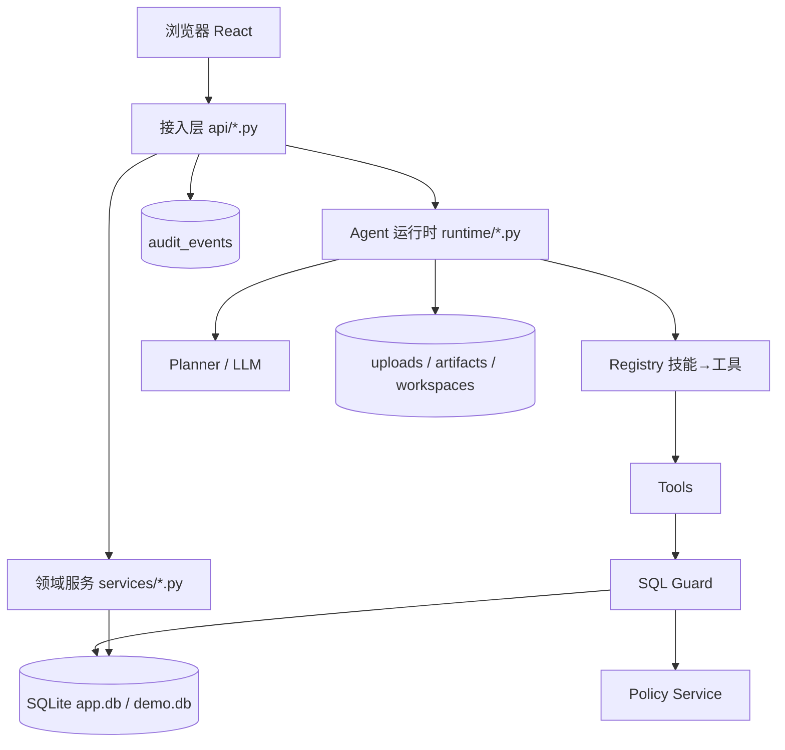
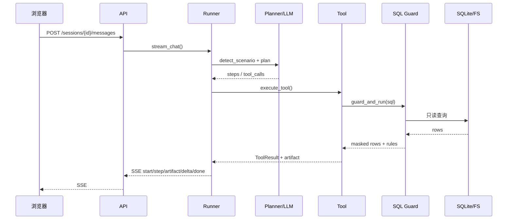

# DataClaw 华为 4+1 设计视图与时序图

> 配套可视化版本（含 42 张内嵌 SVG 时序图）：`docs/08-华为4+1设计视图与时序图.html`
> 状态口径：🟢 已测试 · 🔵 已开发未测试 · ⚫ 初始设计（V2）

## 1. 4+1 视图总览

| 视图 | 关注点 | 本仓库落点 |
|---|---|---|
| 逻辑视图 | 系统由哪些组件组成、职责边界 | `backend/app/{api,services,runtime,core}`；`frontend/src` |
| 过程视图 | 一次请求/对话在运行时如何流动 | FastAPI + SSE + Runner + Planner/LLM + Registry + Tools + sqlguard |
| 开发视图 | 代码如何组织、依赖方向 | api → services/runtime → models；frontend 只走 `/api`；`lean/` 独立 |
| 物理视图 | 部署形态与数据落点 | 单机 Uvicorn:8787 + SQLite + 本地文件；V2 容器/Postgres/Redis/OIDC |
| 场景视图 | 正常与异常场景的时序 | 下文 42 个场景，逐条带代码锚点 |

## 2. 逻辑视图



## 3. 过程视图



## 4. 开发视图

| 模块 | 职责 | 规模/证据 |
|---|---|---|
| `backend/app/api` | HTTP 接入、鉴权、审计、DTO | 16 个路由模块 / 78 操作 |
| `backend/app/services` | 领域服务、权限求值、SQL 网关、知识/渠道 | 8 个服务模块 |
| `backend/app/runtime` | Agent 循环、Planner、工具注册表、HITL、沙箱 | runner/planner/registry/approvals/sandbox + 10 工具 |
| `backend/app/seed` | 演示数据：工时/CRM/合同/知识/技能 | demo.db 28,720 行工时 |
| `backend/tests` | 核心 API / 运行时 / 数据安全 | 7 + 9 + 8 = 24 用例 |
| `frontend/src` | React 页面、组件、SSE 客户端 | 12 页面 + 15 原子组件 |
| `lean/` | Go 单二进制精简实现 | 3.5k 行 / 5 个 Go test |
| `tools/` | 验收、截图、4+1 文档生成 | acceptance.py / manual-*.mjs |

## 5. 物理视图

```mermaid
flowchart LR
  B[浏览器] -->|HTTPS/SSE| U[Uvicorn :8787]
  IM[IM/Webhook] -->|POST /channels/{type}/events| U
  U --> DB[(app.db / demo.db)]
  U --> FS[(uploads / artifacts / workspaces)]
  U -.可选.-> LLM[LLM API]
  subgraph V2[V2 部署形态]
    K8S[K8s + 每会话容器]
    PG[(Postgres)]
    REDIS[(Redis)]
    OIDC[OIDC/SSO]
  end
```

## 6. 场景目录

| ID | 类型 | 状态 | 场景 | 测试证据 |
|---|---|---|---|---|
| N01 | 正常 | 🟢 已测试 | 登录并建立会话令牌 | test_core_api.py::test_login_success_and_failure；tools/acceptance.py（错误口令/身份/health） |
| N02 | 正常 | 🟢 已测试 | 管理员查看运营总览 | test_data_api.py::test_overview_and_metrics；tools/acceptance.py（运营总览） |
| N03 | 正常 | 🟢 已测试 | 基于模板创建个人员工 | test_core_api.py::test_employee_create_skill_and_detail |
| N04 | 正常 | 🟢 已测试 | 公共员工定义、分配与版本发布 | test_core_api.py::test_public_agent_assign_publish_sync；tools/acceptance.py（分配幂等） |
| N05 | 正常 | 🟢 已测试 | 技能生命周期：安装、上传、审核 | test_core_api.py::test_user_skill_pending_scan_review_install；test_memory_and_skill_lifecycle；acceptance（安装/卸载闭环） |
| N06 | 正常 | 🟢 已测试 | Excel 数据源接入与脱敏查询 | test_data_api.py::test_excel_datasource_import；人工角色验收（截图 09/12） |
| N07 | 正常 | 🟢 已测试 | 策略求值与 SQL 安全网关 | test_data_api.py::test_effective_matrix / test_sql_preview_mask_rowfilter_denied；acceptance（掩码/行级/拒绝/DML） |
| N08 | 正常 | 🟢 已测试 | 知识中台上传、解析、检索与 ACL | test_data_api.py::test_knowledge_upload_search_acl / test_upload_parse_failure |
| N09 | 正常 | 🟢 已测试 | 渠道配置、连通测试与入站 Webhook | test_data_api.py::test_channels_and_inbound；acceptance（渠道入站 webhook） |
| N10 | 正常 | 🟢 已测试 | 会话 SSE 与 Agent 工具链运行时 | test_runtime.py::test_scenario_a_sse_protocol / test_session_crud_and_autotitle；test_scenario_a_dashboard_report |
| N11 | 正常 | 🟢 已测试 | 场景 A：工时分析、大屏与深度报告 | test_runtime.py::test_scenario_a_dashboard_report；acceptance（4 图/5 KPI/2914 字/脱敏）；人工截图 23/24 |
| N12 | 正常 | 🟢 已测试 | 场景 B：销售拜访指南 | test_runtime.py::test_scenario_b_sales_guide；acceptance（5743 字节指南）；人工截图 30/31 |
| N13 | 正常 | 🟢 已测试 | 场景 C：合同审查、HITL 与修订版 docx | test_runtime.py::test_scenario_c_contract_docx / test_scenario_c_default_sample_has_risks；acceptance（docx/HITL）；人工截图 34/36 |
| N14 | 正常 | 🔵 已开发未测试 | 记忆读写与自动沉淀 | test_core_api.py::test_memory_and_skill_lifecycle（CRUD）；自动沉淀已手工验证（截图 26），未纳入自动化 |
| N15 | 正常 | 🟢 已测试 | 审计查询、筛选与统计 | test_core_api.py::test_audit_visibility_and_stats；acceptance（denied 审计） |
| N16 | 正常 | 🟢 已测试 | 产物、文件与附件交付 | test_runtime.py::test_scenario_a_dashboard_report（产物下载）；acceptance（docx 下载）；人工截图 33（附件） |
| N17 | 正常 | 🔵 已开发未测试 | LLM function-calling 路径 | 无真实 LLM Key；只有离线 Planner 路径被自动化覆盖 |
| X01 | 异常 | 🟢 已测试 | 认证失败：错误口令、缺少令牌、账号停用 | test_core_api.py::test_login_success_and_failure（错误口令/缺令牌）；停用分支代码已实现，未单独测试 |
| X02 | 异常 | 🟢 已测试 | 越权访问：跨用户员工与管理员接口 | test_core_api.py::test_cross_tenant_and_role_denied；test_audit_visibility_and_stats（部门范围） |
| X03 | 异常 | 🟢 已测试 | 技能异常：未安装、未审核、不可绑定 | test_core_api.py::test_user_skill_pending_scan_review_install（SKILL_NOT_APPROVED）；test_cross_tenant_and_role_denied（SKILL_NOT_INSTALLED） |
| X04 | 异常 | 🟢 已测试 | SQL 拒绝：表、列、DML、多语句、解析失败 | test_data_api.py::test_sql_preview_mask_rowfilter_denied（表/列/DML/LIMIT）；acceptance（DML）；解析/多语句/文件缺失未自动化 |
| X05 | 异常 | 🟢 已测试 | 权限拒绝可解释：聊天、行级、列级 | test_runtime.py::test_permission_denied_is_explainable；test_data_api.py::test_sql_preview_mask_rowfilter_denied |
| X06 | 异常 | 🟢 已测试 | 无技能员工兜底 | test_runtime.py::test_fallback_without_skills |
| X07 | 异常 | 🔵 已开发未测试 | LLM 调用失败降级离线 Planner | 未配置真实 LLM Key；降级分支未自动化 |
| X08 | 异常 | 🟢 已测试 | HITL 异常：拒绝、超时、审批失效 | test_runtime.py::test_approval_timeout_cancels_not_hangs（超时）；test_scenario_c_contract_docx（批准）；拒绝/失效分支未自动化 |
| X09 | 异常 | 🟢 已测试 | SSE 超时与最大步数 | test_runtime.py::test_approval_timeout_cancels_not_hangs（超时收尾）；MAX_STEPS 分支未自动化 |
| X10 | 异常 | 🟢 已测试 | 上传与知识异常：格式、解析、ACL、空检索 | test_data_api.py::test_upload_parse_failure / test_knowledge_upload_search_acl；超限分支未自动化 |
| X11 | 异常 | 🟢 已测试 | 渠道异常：token、未配置、停用 | test_data_api.py::test_channels_and_inbound（token/入站）；停用/未配置分支未自动化 |
| X12 | 异常 | 🔵 已开发未测试 | 数据源与策略异常：连接、Excel、校验 | Excel 正常路径已测（test_excel_datasource_import）；失败路径与策略 CRUD 未自动化 |
| X13 | 异常 | 🟢 已测试 | 公共员工边缘：重复分配、取消、下架 | test_core_api.py::test_public_agent_assign_publish_sync；acceptance（重复分配 created=0） |
| X14 | 异常 | 🟢 已测试 | 审计非法筛选 | test_core_api.py::test_audit_visibility_and_stats |
| X15 | 异常 | 🔵 已开发未测试 | 产物、文件与工作区异常 | 产物下载正常路径已测；404/路径穿越/配额/文件删除未自动化 |
| X16 | 异常 | 🔵 已开发未测试 | 记忆边界：关闭、重复、删除不存在 | test_core_api.py::test_memory_and_skill_lifecycle（删除不存在 404/隔离）；关闭/去重分支未自动化 |
| X17 | 异常 | 🔵 已开发未测试 | 数据安全身份选择器回归（已修复） | 已手工验证（截图 12）；前端无自动化 UI 测试 |
| N18 | 正常 | 🟢 已测试 | 用户、角色与部门管理 | test_core_api.py::test_cross_tenant_and_role_denied（用户 CRUD/部门范围/自我降级） |
| N19 | 正常 | 🔵 已开发未测试 | 策略 CRUD 与生效矩阵 | test_data_api.py::test_effective_matrix（生效矩阵）；策略 CRUD 仅手工验证 |
| X18 | 异常 | 🟢 已测试 | 用户管理异常：重复、自我降级、部门越权 | test_core_api.py::test_cross_tenant_and_role_denied |
| V01 | V2 | ⚫ 初始设计 | V2：容器沙箱执行 | 未实现；接口占位 runtime/sandbox.py:109 DockerProvider；演进路径 docs/03 §12 |
| V02 | V2 | ⚫ 初始设计 | V2：企业 SSO / OIDC 登录 | 未实现；当前登录 api/auth.py:53；演进路径 docs/03 §12 |
| V03 | V2 | ⚫ 初始设计 | V2：IM 长连接与多轮会话 | 未实现；V1 入站 api/channels.py:85；演进路径 docs/03 §12 |
| V04 | V2 | ⚫ 初始设计 | V2：OCR 与向量检索 | 未实现；V1 解析 runtime/tools/doc_parse.py:64、检索 services/knowledge_service.py:367 |
| V05 | V2 | ⚫ 初始设计 | V2：多 Agent 编排、自动技能、真实外搜、多驱动 | 未实现；当前单员工工具链 + 离线模拟外搜 + SQLite/Excel；演进路径 docs/03 §12 |

## 7. 场景与代码锚点

> 每条锚点格式：`文件:行号 函数/关键字`。行号会随重构变化，函数名更稳定。


### 身份与工作台

#### N01 登录并建立会话令牌  🟢

账号口令登录：PBKDF2 校验 → 签发 12h JWT → 写登录审计；后续请求用 Bearer 令牌识别用户，权限在每次请求时重新求值。

- 测试证据：test_core_api.py::test_login_success_and_failure；tools/acceptance.py（错误口令/身份/health）

| # | 交互 | 代码锚点 | 状态 |
|---|---|---|---|
| 1 | 浏览器 → API | `frontend/src/pages/Login.tsx:23 submit()` | 🟢 |
| 2 | API → DB | `api/auth.py:53 login()` | 🟢 |
| 3 | API → Auth | `core/security.py:23 verify_password()` | 🟢 |
| 4 | API → Audit | `core/deps.py:60 audit()` | 🟢 |
| 5 | API → 浏览器 | `core/security.py:32 create_token()` | 🟢 |
| 6 | 浏览器 → API | `api/auth.py:108 me()` | 🟢 |
| 7 | API → 浏览器 | `api/auth.py:40 permissions_for()` | 🟢 |

#### N02 管理员查看运营总览  🟢

总览把员工、会话、工具调用、越权拦截、技能、活跃用户与近 7 日趋势聚合到一个页面，回答“投了多少、用了多少、拦了多少”。

- 测试证据：test_data_api.py::test_overview_and_metrics；tools/acceptance.py（运营总览）

| # | 交互 | 代码锚点 | 状态 |
|---|---|---|---|
| 1 | 浏览器 → API | `frontend/src/pages/admin/Overview.tsx` | 🟢 |
| 2 | API → DB | `api/overview.py:29 overview()` | 🟢 |
| 3 | API → Audit | `api/overview.py:29 overview()` | 🟢 |
| 4 | API → 浏览器 | `api/overview.py:29 overview()` | 🟢 |


### 员工与公共员工

#### N03 基于模板创建个人员工  🟢

从角色模板复制 SOUL、职位、头像和默认技能，生成属于当前用户的员工；员工执行任务时始终继承绑定用户的权限。

- 测试证据：test_core_api.py::test_employee_create_skill_and_detail

| # | 交互 | 代码锚点 | 状态 |
|---|---|---|---|
| 1 | 浏览器 → API | `frontend/src/pages/Employees.tsx:305 submitCreate()` | 🟢 |
| 2 | API → EmployeeSvc | `services/employee_service.py:296 create_employee_from_template()` | 🟢 |
| 3 | EmployeeSvc → DB | `services/employee_service.py:296` | 🟢 |
| 4 | API → Audit | `api/employees.py:79 create_employee()` | 🟢 |
| 5 | API → 浏览器 | `services/employee_service.py:208 employee_detail()` | 🟢 |

#### N04 公共员工定义、分配与版本发布  🟢

管理员统一定义 SOUL 与技能；分配时为每个用户生成独立副本（幂等）；改版后版本 +1，发布时同步全部副本，但保留用户侧个性化。

- 测试证据：test_core_api.py::test_public_agent_assign_publish_sync；tools/acceptance.py（分配幂等）

| # | 交互 | 代码锚点 | 状态 |
|---|---|---|---|
| 1 | 浏览器 → API | `frontend/src/pages/admin/PublicAgents.tsx:295 submitForm()` | 🟢 |
| 2 | API → DB | `api/public_agents.py:174 create_agent()` | 🟢 |
| 3 | 浏览器 → API | `frontend/src/pages/admin/PublicAgents.tsx:213 submitAssign()` | 🟢 |
| 4 | API → AgentSvc | `services/assignment_service.py:67 assign_users()` | 🟢 |
| 5 | 浏览器 → API | `frontend/src/pages/admin/PublicAgents.tsx:312 submitForm()` | 🟢 |
| 6 | API → DB | `api/public_agents.py:217 patch_agent()` | 🟢 |
| 7 | 浏览器 → API | `frontend/src/pages/admin/PublicAgents.tsx:244 publish()` | 🟢 |
| 8 | AgentSvc → DB | `services/assignment_service.py:146 sync_assignments()` | 🟢 |
| 9 | API → Audit | `api/public_agents.py:279 publish_agent()` | 🟢 |


### 技能

#### N05 技能生命周期：安装、上传、审核  🟢

技能 → 工具清单 → 员工装载。未装载技能时运行时根本不注册对应工具；用户技能需静态扫描 + 管理员审核后才能被他人安装。

- 测试证据：test_core_api.py::test_user_skill_pending_scan_review_install；test_memory_and_skill_lifecycle；acceptance（安装/卸载闭环）
- 说明：未审核安装会在 install_skill() 返回 403 SKILL_NOT_APPROVED；未安装技能绑定员工会在 can_bind_skill() 返回 403。

| # | 交互 | 代码锚点 | 状态 |
|---|---|---|---|
| 1 | 浏览器 → API | `frontend/src/pages/Skills.tsx:176 load()` | 🟢 |
| 2 | 浏览器 → API | `frontend/src/pages/Skills.tsx:220 install()` | 🟢 |
| 3 | API → SkillSvc | `services/skill_service.py:202 can_install()` | 🟢 |
| 4 | API → DB | `api/skills.py:147 install_skill()` | 🟢 |
| 5 | 浏览器 → API | `frontend/src/pages/Skills.tsx:245 submitCreate()` | 🟢 |
| 6 | API → SkillSvc | `services/skill_service.py:38 scan_skill_content()` | 🟢 |
| 7 | 浏览器 → API | `api/skills.py:382 review_skill()` | 🟢 |
| 8 | 浏览器 → API | `api/skills.py:197 uninstall_skill()` | 🟢 |
| 9 | API → Audit | `api/skills.py:147 / 382 / 197` | 🟢 |


### 数据与权限

#### N06 Excel 数据源接入与脱敏查询  🟢

Excel 作为接入格式：openpyxl 读取每个工作表 → 导入只读 SQLite → 自动建表/推断类型/识别敏感列 → 复用同一套表/列/行策略与 SQL 网关。

- 测试证据：test_data_api.py::test_excel_datasource_import；人工角色验收（截图 09/12）
- 说明：首行必须是表头；.xls 需另存为 .xlsx；新数据源默认只有平台管理员可见，业务用户需显式 allow。

| # | 交互 | 代码锚点 | 状态 |
|---|---|---|---|
| 1 | 浏览器 → API | `frontend/src/pages/admin/DataSecurity.tsx:586 submitSource()` | 🟢 |
| 2 | API → DsSvc | `services/datasource_service.py:390 create()` | 🟢 |
| 3 | DsSvc → Excel | `services/datasource_service.py:256 import_excel()` | 🟢 |
| 4 | DsSvc → DB | `services/datasource_service.py:242 _classify_column()` | 🟢 |
| 5 | DsSvc → DB | `services/datasource_service.py:390 create()` | 🟢 |
| 6 | API → DsSvc | `services/datasource_service.py:339 test_connection()` | 🟢 |
| 7 | 浏览器 → API | `frontend/src/pages/admin/DataSecurity.tsx:714 runPreview()` | 🟢 |
| 8 | API → Guard | `services/sqlguard.py:294 guard_and_run()` | 🟢 |

#### N07 策略求值与 SQL 安全网关  🟢

五层策略（数据源/表/列/行/指标）按“用户优先于角色、priority 大者优先”求值；SQL 网关做单条 SELECT 校验、表列鉴权、SELECT * 展开、行级注入、强制 LIMIT、结果脱敏与审计。

- 测试证据：test_data_api.py::test_effective_matrix / test_sql_preview_mask_rowfilter_denied；acceptance（掩码/行级/拒绝/DML）
- 说明：默认拒绝：没有 allow 策略的表不可见；用户级策略优先于角色级；行级过滤以 AND 合并。

| # | 交互 | 代码锚点 | 状态 |
|---|---|---|---|
| 1 | 浏览器 → API | `frontend/src/pages/admin/DataSecurity.tsx:697 loadEffective()` | 🟢 |
| 2 | API → Policy | `services/policy_service.py:180 load_policies()` | 🟢 |
| 3 | Policy → API | `services/policy_service.py:300 _resolve_impl()` | 🟢 |
| 4 | 浏览器 → API | `frontend/src/pages/admin/DataSecurity.tsx:714 runPreview()` | 🟢 |
| 5 | API → Guard | `services/sqlguard.py:294 guard_and_run()` | 🟢 |
| 6 | Guard | `services/sqlguard.py:294` | 🟢 |
| 7 | Guard → Policy | `services/sqlguard.py:294` | 🟢 |
| 8 | Guard | `services/sqlguard.py:294` | 🟢 |
| 9 | Guard → DB | `services/sqlguard.py:294` | 🟢 |
| 10 | Guard → Policy | `services/policy_service.py:283 mask_row()` | 🟢 |
| 11 | Guard → Audit | `services/sqlguard.py:144 _audit()` | 🟢 |


### 知识 / 渠道

#### N08 知识中台上传、解析、检索与 ACL  🟢

文档上传后真实解析（PDF/DOCX/TXT/MD），切片入库；检索用中文 2-gram + BM25，返回片段/出处/分数，并遵守文档 ACL。

- 测试证据：test_data_api.py::test_knowledge_upload_search_acl / test_upload_parse_failure

| # | 交互 | 代码锚点 | 状态 |
|---|---|---|---|
| 1 | 浏览器 → API | `frontend/src/pages/admin/Knowledge.tsx:201 onPickFiles()` | 🟢 |
| 2 | API → KnowledgeSvc | `services/knowledge_service.py:180 create_from_file()` | 🟢 |
| 3 | KnowledgeSvc → DB | `services/knowledge_service.py:134 create_doc()` | 🟢 |
| 4 | 浏览器 → API | `frontend/src/pages/admin/Knowledge.tsx:225 runSearch()` | 🟢 |
| 5 | API → KnowledgeSvc | `services/knowledge_service.py:367 search()` | 🟢 |
| 6 | KnowledgeSvc → DB | `services/knowledge_service.py:269 can_read()` | 🟢 |
| 7 | API → 浏览器 | `api/knowledge.py:218 search_knowledge()` | 🟢 |

#### N09 渠道配置、连通测试与入站 Webhook  🟢

管理员保存飞书/企微/钉钉/Web/API 配置并测试；入站 webhook 校验 token，调用运行时生成知识库应答，全程审计。

- 测试证据：test_data_api.py::test_channels_and_inbound；acceptance（渠道入站 webhook）

| # | 交互 | 代码锚点 | 状态 |
|---|---|---|---|
| 1 | 浏览器 → API | `frontend/src/pages/admin/Channels.tsx:256 saveChannel()` | 🟢 |
| 2 | API → ChannelSvc | `services/channel_service.py:170 save_channel()` | 🟢 |
| 3 | 浏览器 → API | `frontend/src/pages/admin/Channels.tsx:277 testChannel()` | 🟢 |
| 4 | API → ChannelSvc | `services/channel_service.py:197 test_channel()` | 🟢 |
| 5 | IM/Web → API | `api/channels.py:85 inbound_event()` | 🟢 |
| 6 | API → ChannelSvc | `services/channel_service.py:250 _verify_token()` | 🟢 |
| 7 | ChannelSvc → Runner | `services/channel_service.py:263 _runtime_reply()` | 🟢 |
| 8 | API → Audit | `api/channels.py:85 inbound_event()` | 🟢 |


### 会话与运行时

#### N10 会话 SSE 与 Agent 工具链运行时  🟢

会话消息以 SSE 返回 start/step/artifact/delta/approval/done；运行时按已装技能注册工具，离线 Planner 或 LLM 产出步骤，工具真实执行并持久化产物/消息/记忆。

- 测试证据：test_runtime.py::test_scenario_a_sse_protocol / test_session_crud_and_autotitle；test_scenario_a_dashboard_report
- 说明：未装技能 = 运行时没有工具；工具调用与 SQL 都写 tool_calls + audit_events。

| # | 交互 | 代码锚点 | 状态 |
|---|---|---|---|
| 1 | 浏览器 → API | `frontend/src/pages/Chat.tsx:591 streamChat()` | 🟢 |
| 2 | API → Runner | `api/sessions.py:281 send_message()` | 🟢 |
| 3 | Runner → Registry | `runtime/runner.py:31 / runtime/registry.py:100` | 🟢 |
| 4 | Runner → Planner | `runtime/planner.py:85 / 101` | 🟢 |
| 5 | Runner → Tool | `runtime/registry.py:135 execute_tool()` | 🟢 |
| 6 | Tool → DB | `runtime/runner.py:248 _run_step()` | 🟢 |
| 7 | Runner → FS | `runtime/artifacts.py:42 save_artifact()` | 🟢 |
| 8 | Runner → API | `runtime/runner.py:368 _execute()` | 🟢 |
| 9 | Runner → DB | `runtime/runner.py:597 / 634` | 🟢 |


### 三条标杆场景

#### N11 场景 A：工时分析、大屏与深度报告  🟢

自然语言问数 → 识别数据集/字段 → 生成 SQL → 经数据权限网关（行级过滤 + 薪资脱敏）→ 5 KPI + 4 图大屏 → ≥1200 字深度报告。

- 测试证据：test_runtime.py::test_scenario_a_dashboard_report；acceptance（4 图/5 KPI/2914 字/脱敏）；人工截图 23/24
- 说明：大屏不靠 LLM 自由写 SQL：模板化 SQL + 网关；图表数字来自真实结果集。

| # | 交互 | 代码锚点 | 状态 |
|---|---|---|---|
| 1 | Runner → ChatBI | `runtime/tools/chatbi.py:71 list_tables_handler()` | 🟢 |
| 2 | Runner → ChatBI | `runtime/tools/chatbi.py:93 describe_table_handler()` | 🟢 |
| 3 | Runner → ChatBI | `runtime/tools/chatbi.py:256 ask_handler()` | 🟢 |
| 4 | ChatBI → Guard | `services/sqlguard.py:294` | 🟢 |
| 5 | Guard → DB | `services/sqlguard.py:294` | 🟢 |
| 6 | Runner → Dashboard | `runtime/tools/dashboard.py:70 build_handler()` | 🟢 |
| 7 | Runner → Report | `runtime/tools/report.py:55 compose_handler()` | 🟢 |
| 8 | Runner → 浏览器 | `runtime/runner.py:332 _publish_artifact()` | 🟢 |

#### N12 场景 B：销售拜访指南  🟢

客户 360（CRM，受行级权限）→ 外部情报（演示为离线模拟并标注）→ 知识库方法论 → 结构化拜访指南（客户 360 + 需求预判 + 话术）。

- 测试证据：test_runtime.py::test_scenario_b_sales_guide；acceptance（5743 字节指南）；人工截图 30/31
- 说明：客户名不在名下时改用当前用户客户并在回答中明示，不越权返回。

| # | 交互 | 代码锚点 | 状态 |
|---|---|---|---|
| 1 | Runner → Sales | `runtime/tools/sales_intel.py:98 customer360_handler()` | 🟢 |
| 2 | Sales → DB | `runtime/tools/sales_intel.py:91 _query()` | 🟢 |
| 3 | Runner → WebSearch | `runtime/tools/web_search.py:101 search_handler()` | 🟢 |
| 4 | Runner → Knowledge | `runtime/tools/knowledge_search.py:9 search_handler()` | 🟢 |
| 5 | Runner → Sales | `runtime/tools/sales_intel.py:238 visit_guide_handler()` | 🟢 |
| 6 | Sales → 浏览器 | `runtime/tools/sales_intel.py:334 _render_guide_html()` | 🟢 |

#### N13 场景 C：合同审查、HITL 与修订版 docx  🟢

解析合同 → 匹配企业规则库 → 逐条风险分级 → HITL 审批 → 生成带 w:ins/w:del 修订痕迹的 docx；审批与导出全程审计。

- 测试证据：test_runtime.py::test_scenario_c_contract_docx / test_scenario_c_default_sample_has_risks；acceptance（docx/HITL）；人工截图 34/36

| # | 交互 | 代码锚点 | 状态 |
|---|---|---|---|
| 1 | Runner → DocParse | `runtime/tools/doc_parse.py:171 parse_text_handler()` | 🟢 |
| 2 | Runner → Knowledge | `runtime/tools/knowledge_search.py:9` | 🟢 |
| 3 | Runner → Contract | `runtime/tools/contract.py:90 / 651` | 🟢 |
| 4 | Contract → Approvals | `runtime/approvals.py:67 request_approval()` | 🟢 |
| 5 | Approvals → 浏览器 | `runtime/runner.py:368 _execute()` | 🟢 |
| 6 | 浏览器 → API | `frontend/src/pages/Chat.tsx:701` | 🟢 |
| 7 | API → Approvals | `api/sessions.py:348 decide_approval()` | 🟢 |
| 8 | Contract → FS | `runtime/tools/contract.py:494 / 698` | 🟢 |
| 9 | Runner → Audit | `runtime/approvals.py:207 decide_approval()` | 🟢 |


### 记忆 / 审计 / 交付

#### N14 记忆读写与自动沉淀  🔵

员工记忆按员工隔离：显式偏好即时落库；成功完成标杆场景后沉淀一条“任务打法”（工具链 + 交付物），同场景去重；记忆进入下一轮系统提示词。

- 测试证据：test_core_api.py::test_memory_and_skill_lifecycle（CRUD）；自动沉淀已手工验证（截图 26），未纳入自动化
- 说明：自动沉淀没有独立自动化用例；删除不存在的记忆返回 404 已在 CRUD 用例中覆盖。

| # | 交互 | 代码锚点 | 状态 |
|---|---|---|---|
| 1 | 浏览器 → Runner | `runtime/runner.py:634 _auto_memorize()` | 🔵 |
| 2 | Runner → DB | `runtime/runner.py:634` | 🔵 |
| 3 | 浏览器 → Runner | `runtime/runner.py:634` | 🔵 |
| 4 | Runner → DB | `runtime/runner.py:634` | 🔵 |
| 5 | 浏览器 → API | `api/employees.py:238 get_memory()` | 🟢 |
| 6 | API → EmployeeSvc | `services/employee_service.py:179` | 🟢 |
| 7 | 浏览器 → API | `api/employees.py:268 delete_memory()` | 🟢 |
| 8 | Runner | `runtime/runner.py:51 _employee_memories()` | 🔵 |

#### N15 审计查询、筛选与统计  🟢

登录、会话、工具、SQL、导出、技能、分配、策略、审批全链路入账；成员只看自己，部门管理员看本部门，平台管理员看全部；支持动作/风险/结果/时间筛选。

- 测试证据：test_core_api.py::test_audit_visibility_and_stats；acceptance（denied 审计）

| # | 交互 | 代码锚点 | 状态 |
|---|---|---|---|
| 1 | 浏览器 → API | `frontend/src/pages/admin/Audit.tsx:150 loadAudit()` | 🟢 |
| 2 | API → DB | `api/audit.py:63 visibility_filter() / 78 list_audit()` | 🟢 |
| 3 | API → 浏览器 | `api/audit.py:78 list_audit()` | 🟢 |
| 4 | 浏览器 → API | `frontend/src/pages/admin/Audit.tsx:171` | 🟢 |
| 5 | API → DB | `api/audit.py:154 audit_stats()` | 🟢 |

#### N16 产物、文件与附件交付  🟢

产物（dashboard/report/html/docx）随会话持久化，支持列表/详情/鉴权下载；文件上传后作为附件随消息进入运行时解析。

- 测试证据：test_runtime.py::test_scenario_a_dashboard_report（产物下载）；acceptance（docx 下载）；人工截图 33（附件）
- 说明：文件上传/附件注入没有独立自动化用例；合同附件链路已人工验收（截图 33）。

| # | 交互 | 代码锚点 | 状态 |
|---|---|---|---|
| 1 | 浏览器 → API | `api/artifacts.py:32 list_artifacts()` | 🟢 |
| 2 | API → DB | `api/artifacts.py:19 _owned_artifact()` | 🟢 |
| 3 | 浏览器 → API | `api/artifacts.py:69 download_artifact()` | 🟢 |
| 4 | API → FS | `runtime/artifacts.py:102 artifact_file()` | 🟢 |
| 5 | 浏览器 → API | `api/files.py:40 upload_file()` | 🔵 |
| 6 | API → DB | `api/files.py:40 upload_file()` | 🔵 |
| 7 | 浏览器 → API | `api/sessions.py:115 _normalize_attachments()` | 🔵 |


### 会话与运行时

#### N17 LLM function-calling 路径  🔵

配置 DATACLAW_LLM_API_KEY 后走 OpenAI 兼容 Provider：system prompt + 工具 schema → tool_calls → 注册表执行 → 最终回答；工具层与离线 Planner 完全复用。

- 测试证据：无真实 LLM Key；只有离线 Planner 路径被自动化覆盖
- 说明：生产接入时只需配置 Key；无 Key 时自动降级离线确定性 Planner。

| # | 交互 | 代码锚点 | 状态 |
|---|---|---|---|
| 1 | Runner → LLM | `runtime/llm.py:30 OpenAICompatibleProvider.complete()` | 🔵 |
| 2 | LLM → Runner | `runtime/llm.py:83 tool_call_to_step()` | 🔵 |
| 3 | Runner → Registry | `runtime/registry.py:135` | 🔵 |
| 4 | Runner → Tool | `runtime/runner.py:248 _run_step()` | 🔵 |
| 5 | Runner | `runtime/runner.py:416 get_provider()` | 🔵 |


### 身份与工作台

#### X01 认证失败：错误口令、缺少令牌、账号停用  🟢

错误口令 → 401 BAD_CREDENTIALS + denied 审计；缺少令牌 → 401 UNAUTHORIZED；账号停用 → 403 ACCOUNT_DISABLED（停用分支未自动化）。

- 测试证据：test_core_api.py::test_login_success_and_failure（错误口令/缺令牌）；停用分支代码已实现，未单独测试
- 说明：停用账号分支只有代码，没有自动化用例；排查时看 auth.py login() 的 status 判断与 audit reason=account_disabled。

| # | 交互 | 代码锚点 | 状态 |
|---|---|---|---|
| 1 | 浏览器 → API | `api/auth.py:53 login()` | 🟢 |
| 2 | API → Auth | `core/security.py:23` | 🟢 |
| 3 | API → Audit | `core/deps.py:60 audit()` | 🟢 |
| 4 | API → 浏览器 | `api/auth.py:53` | 🟢 |
| 5 | 浏览器 → API | `core/deps.py:24 get_current_user()` | 🟢 |
| 6 | API → 浏览器 | `core/deps.py:24` | 🟢 |
| 7 | API → DB | `api/auth.py:53` | 🔵 |
| 8 | API → 浏览器 | `api/auth.py:53` | 🔵 |

#### X02 越权访问：跨用户员工与管理员接口  🟢

员工读写校验 owner（管理员可读）；成员访问用户管理/公共员工管理返回 403；部门管理员只能看本部门用户，且不能授予平台管理员。

- 测试证据：test_core_api.py::test_cross_tenant_and_role_denied；test_audit_visibility_and_stats（部门范围）

| # | 交互 | 代码锚点 | 状态 |
|---|---|---|---|
| 1 | 浏览器 → API | `api/employees.py:117 / 129 / 182` | 🟢 |
| 2 | API → EmployeeSvc | `services/employee_service.py:55 / 71` | 🟢 |
| 3 | API → 浏览器 | `services/employee_service.py:55` | 🟢 |
| 4 | 浏览器 → API | `api/users.py:128` | 🟢 |
| 5 | API → 浏览器 | `core/deps.py:50 require_admin()` | 🟢 |
| 6 | 浏览器 → API | `api/public_agents.py:174` | 🟢 |
| 7 | API → Audit | `core/deps.py:60 audit()` | 🟢 |


### 技能

#### X03 技能异常：未安装、未审核、不可绑定  🟢

安装/绑定技能时校验：技能是否已审核、当前用户是否已安装、是否允许绑定到该员工；不满足时返回具体中文错误码，而不是静默失败。

- 测试证据：test_core_api.py::test_user_skill_pending_scan_review_install（SKILL_NOT_APPROVED）；test_cross_tenant_and_role_denied（SKILL_NOT_INSTALLED）

| # | 交互 | 代码锚点 | 状态 |
|---|---|---|---|
| 1 | 浏览器 → API | `api/skills.py:147 install_skill()` | 🟢 |
| 2 | API → SkillSvc | `services/skill_service.py:202 can_install()` | 🟢 |
| 3 | API → 浏览器 | `api/skills.py:147` | 🟢 |
| 4 | 浏览器 → API | `api/employees.py:207 configure_skill()` | 🟢 |
| 5 | API → SkillSvc | `services/skill_service.py:186 can_bind_skill()` | 🟢 |
| 6 | API → 浏览器 | `api/employees.py:207` | 🟢 |


### 数据与权限

#### X04 SQL 拒绝：表、列、DML、多语句、解析失败  🟢

网关只允许单条 SELECT/WITH；表未授权、显式引用拒绝列、DML、多语句、解析失败、数据源文件缺失都返回可读原因并写 denied/error 审计。

- 测试证据：test_data_api.py::test_sql_preview_mask_rowfilter_denied（表/列/DML/LIMIT）；acceptance（DML）；解析/多语句/文件缺失未自动化
- 说明：解析失败/多语句/文件缺失分支没有独立自动化用例；排查时看 sqlguard.py 的 guard_and_run 与 _deny/_audit。

| # | 交互 | 代码锚点 | 状态 |
|---|---|---|---|
| 1 | 浏览器 → API | `api/policies.py:254 preview_sql()` | 🟢 |
| 2 | API → Guard | `services/sqlguard.py:294` | 🟢 |
| 3 | Guard → Audit | `services/sqlguard.py:294` | 🔵 |
| 4 | Guard | `services/sqlguard.py:189 _find_forbidden()` | 🟢 |
| 5 | Guard → Policy | `services/policy_service.py:300` | 🟢 |
| 6 | Guard → 浏览器 | `services/sqlguard.py:294` | 🟢 |
| 7 | Guard → Audit | `services/sqlguard.py:144 _audit()` | 🟢 |
| 8 | Guard → DB | `services/sqlguard.py:294` | 🔵 |

#### X05 权限拒绝可解释：聊天、行级、列级  🟢

会话内工具被拒绝时，回答明确说明“无权/未授权/可见的表”，并提示找管理员授权；审计写 tool_call result=denied risk=high。

- 测试证据：test_runtime.py::test_permission_denied_is_explainable；test_data_api.py::test_sql_preview_mask_rowfilter_denied

| # | 交互 | 代码锚点 | 状态 |
|---|---|---|---|
| 1 | 浏览器 → Runner | `runtime/planner.py:85 detect_scenario()` | 🟢 |
| 2 | Runner → Tool | `runtime/tools/chatbi.py:256` | 🟢 |
| 3 | Tool → Guard | `services/sqlguard.py:294` | 🟢 |
| 4 | Guard → Tool | `services/policy_service.py:300` | 🟢 |
| 5 | Runner → 浏览器 | `runtime/runner.py:514` | 🟢 |
| 6 | Runner → Audit | `runtime/runner.py:248 _run_step()` | 🟢 |


### 会话与运行时

#### X06 无技能员工兜底  🟢

员工没有装载任何技能时，运行时不注册工具；Planner 返回能力介绍，不臆造数据，也不调用工具；会话仍可正常查看。

- 测试证据：test_runtime.py::test_fallback_without_skills

| # | 交互 | 代码锚点 | 状态 |
|---|---|---|---|
| 1 | 浏览器 → Runner | `api/sessions.py:281` | 🟢 |
| 2 | Runner → Registry | `runtime/registry.py:100` | 🟢 |
| 3 | Runner → Planner | `runtime/planner.py:101` | 🟢 |
| 4 | Planner → Runner | `runtime/planner.py:219 _fallback_text()` | 🟢 |
| 5 | Runner → 浏览器 | `runtime/runner.py:368` | 🟢 |

#### X07 LLM 调用失败降级离线 Planner  🔵

LLM 超时/异常/未配置时，捕获异常、发 error 事件（LLM_FALLBACK），继续走离线确定性 Planner，保证会话不中断。

- 测试证据：未配置真实 LLM Key；降级分支未自动化

| # | 交互 | 代码锚点 | 状态 |
|---|---|---|---|
| 1 | Runner → LLM | `runtime/llm.py:30` | 🔵 |
| 2 | LLM → Runner | `runtime/runner.py:445` | 🔵 |
| 3 | Runner → 浏览器 | `runtime/runner.py:445` | 🔵 |
| 4 | Runner → Planner | `runtime/planner.py:101` | 🔵 |
| 5 | Runner → Tool | `runtime/registry.py:135` | 🔵 |


### 三条标杆场景

#### X08 HITL 异常：拒绝、超时、审批失效  🟢

审批被拒绝则跳过导出；超时自动取消并收尾（不永久挂起）；审批已失效返回 APPROVAL_NOT_FOUND；结果全部写审计。

- 测试证据：test_runtime.py::test_approval_timeout_cancels_not_hangs（超时）；test_scenario_c_contract_docx（批准）；拒绝/失效分支未自动化
- 说明：超时与批准已测；显式拒绝与审批失效只有代码，未单独自动化。

| # | 交互 | 代码锚点 | 状态 |
|---|---|---|---|
| 1 | Runner → Approvals | `runtime/approvals.py:67` | 🟢 |
| 2 | Approvals → 浏览器 | `runtime/runner.py:368` | 🟢 |
| 3 | 浏览器 → API | `frontend/src/pages/Chat.tsx:701` | 🟢 |
| 4 | API → Approvals | `runtime/approvals.py:207` | 🔵 |
| 5 | API → 浏览器 | `api/sessions.py:348` | 🔵 |
| 6 | Approvals → Audit | `runtime/approvals.py:207` | 🟢 |
| 7 | Runner → FS | `runtime/tools/contract.py:698` | 🔵 |


### 会话与运行时

#### X09 SSE 超时与最大步数  🟢

单轮执行超过 SSE 超时或达到 MAX_STEPS 时，发 error 事件并提前结束，最终仍发 done，前端不会永远转圈。

- 测试证据：test_runtime.py::test_approval_timeout_cancels_not_hangs（超时收尾）；MAX_STEPS 分支未自动化
- 说明：审批超时用例覆盖了超时后的收尾；普通工具链 MAX_STEPS 分支未自动化。

| # | 交互 | 代码锚点 | 状态 |
|---|---|---|---|
| 1 | 浏览器 → API | `api/sessions.py:281` | 🟢 |
| 2 | Runner | `runtime/runner.py:465` | 🔵 |
| 3 | Runner | `runtime/runner.py:462` | 🔵 |
| 4 | Runner → 浏览器 | `runtime/runner.py:462` | 🟢 |
| 5 | Runner → 浏览器 | `runtime/runner.py:368` | 🟢 |


### 知识 / 渠道

#### X10 上传与知识异常：格式、解析、ACL、空检索  🟢

不支持的文件格式、解析失败、无权限文档、空检索词都返回中文 400/403；不会静默成功或返回空结果冒充成功。

- 测试证据：test_data_api.py::test_upload_parse_failure / test_knowledge_upload_search_acl；超限分支未自动化

| # | 交互 | 代码锚点 | 状态 |
|---|---|---|---|
| 1 | 浏览器 → API | `api/knowledge.py:106 upload_doc()` | 🟢 |
| 2 | API → 浏览器 | `api/knowledge.py:106` | 🟢 |
| 3 | 浏览器 → API | `api/knowledge.py:218` | 🟢 |
| 4 | API → 浏览器 | `api/knowledge.py:218` | 🟢 |
| 5 | 浏览器 → API | `services/knowledge_service.py:367` | 🔵 |
| 6 | KnowledgeSvc → DB | `services/knowledge_service.py:269` | 🟢 |
| 7 | 浏览器 → API | `api/files.py:40` | 🔵 |

#### X11 渠道异常：token、未配置、停用  🟢

入站 webhook 校验 token；渠道未配置或停用时拒绝；测试连接失败返回可读原因；事件仍尽量写审计。

- 测试证据：test_data_api.py::test_channels_and_inbound（token/入站）；停用/未配置分支未自动化

| # | 交互 | 代码锚点 | 状态 |
|---|---|---|---|
| 1 | IM/Web → API | `api/channels.py:85` | 🟢 |
| 2 | API → ChannelSvc | `services/channel_service.py:250` | 🟢 |
| 3 | API → IM/Web | `api/channels.py:85` | 🟢 |
| 4 | ChannelSvc → DB | `services/channel_service.py:309` | 🔵 |
| 5 | API → IM/Web | `services/channel_service.py:309` | 🔵 |
| 6 | API → Audit | `api/channels.py:85` | 🟢 |


### 数据与权限

#### X12 数据源与策略异常：连接、Excel、校验  🔵

数据源连接失败、Excel 文件不存在/后缀不对/无工作表、策略主体或资源缺失都返回具体 400；Excel 导入失败会清理临时库。

- 测试证据：Excel 正常路径已测（test_excel_datasource_import）；失败路径与策略 CRUD 未自动化

| # | 交互 | 代码锚点 | 状态 |
|---|---|---|---|
| 1 | 浏览器 → API | `api/datasources.py:30` | 🔵 |
| 2 | API → DsSvc | `services/datasource_service.py:390` | 🔵 |
| 3 | DsSvc → Excel | `services/datasource_service.py:256` | 🔵 |
| 4 | API → 浏览器 | `api/datasources.py:30` | 🔵 |
| 5 | 浏览器 → API | `api/policies.py:144` | 🔵 |
| 6 | API → 浏览器 | `api/policies.py:144` | 🔵 |


### 员工与公共员工

#### X13 公共员工边缘：重复分配、取消、下架  🟢

重复分配幂等返回 created=0/skipped=N；取消分配删除用户副本；下架后不再可分配，但已分配副本保留。

- 测试证据：test_core_api.py::test_public_agent_assign_publish_sync；acceptance（重复分配 created=0）

| # | 交互 | 代码锚点 | 状态 |
|---|---|---|---|
| 1 | 浏览器 → API | `api/public_agents.py:316 assign()` | 🟢 |
| 2 | API → AgentSvc | `services/assignment_service.py:67` | 🟢 |
| 3 | API → 浏览器 | `api/public_agents.py:316` | 🟢 |
| 4 | 浏览器 → API | `api/public_agents.py:374 unassign()` | 🟢 |
| 5 | AgentSvc → DB | `services/assignment_service.py:194` | 🟢 |
| 6 | 浏览器 → API | `api/public_agents.py:408 offline_agent()` | 🟢 |


### 记忆 / 审计 / 交付

#### X14 审计非法筛选  🟢

非法 risk/from 参数返回 400；未来时间范围返回空集；成员只能看自己的审计，部门管理员只能看本部门。

- 测试证据：test_core_api.py::test_audit_visibility_and_stats

| # | 交互 | 代码锚点 | 状态 |
|---|---|---|---|
| 1 | 浏览器 → API | `api/audit.py:78 list_audit()` | 🟢 |
| 2 | API → 浏览器 | `api/audit.py:78` | 🟢 |
| 3 | 浏览器 → API | `api/audit.py:45 _parse_time()` | 🟢 |
| 4 | API → 浏览器 | `api/audit.py:45` | 🟢 |
| 5 | 浏览器 → API | `api/audit.py:63 visibility_filter()` | 🟢 |
| 6 | API → 浏览器 | `api/audit.py:63` | 🟢 |

#### X15 产物、文件与工作区异常  🔵

产物不存在/无权下载返回 404；文件不存在返回 404；工作区路径穿越、配额超限、删除不存在文件都返回明确错误，不越界写盘。

- 测试证据：产物下载正常路径已测；404/路径穿越/配额/文件删除未自动化

| # | 交互 | 代码锚点 | 状态 |
|---|---|---|---|
| 1 | 浏览器 → API | `api/artifacts.py:55 get_artifact()` | 🔵 |
| 2 | API → 浏览器 | `api/artifacts.py:19 _owned_artifact()` | 🔵 |
| 3 | 浏览器 → API | `api/files.py:150 download_file()` | 🔵 |
| 4 | API → 浏览器 | `api/files.py:32 _file_or_404()` | 🔵 |
| 5 | API → FS | `runtime/sandbox.py:28 _safe_join()` | 🔵 |
| 6 | FS → API | `runtime/sandbox.py:40 LocalProvider.write()` | 🔵 |

#### X16 记忆边界：关闭、重复、删除不存在  🔵

员工关闭记忆后不读写记忆；重复偏好按内容去重；删除不存在的记忆返回 404；记忆按员工隔离，不能跨员工删除。

- 测试证据：test_core_api.py::test_memory_and_skill_lifecycle（删除不存在 404/隔离）；关闭/去重分支未自动化

| # | 交互 | 代码锚点 | 状态 |
|---|---|---|---|
| 1 | Runner → DB | `runtime/runner.py:634` | 🔵 |
| 2 | Runner → DB | `runtime/runner.py:634` | 🔵 |
| 3 | 浏览器 → API | `api/employees.py:268 delete_memory()` | 🟢 |
| 4 | API → 浏览器 | `api/employees.py:268` | 🟢 |
| 5 | 浏览器 → API | `api/employees.py:268` | 🟢 |
| 6 | API → 浏览器 | `services/employee_service.py:71 assert_employee_writable()` | 🟢 |


### 数据与权限

#### X17 数据安全身份选择器回归（已修复）  🔵

问题：SQL 改写预览选择“以当前账号身份”（空值）后，初始化 effect 会立刻重置回 analyst，导致无法以管理员身份预览。修复：首屏只初始化一次，允许空值。

- 测试证据：已手工验证（截图 12）；前端无自动化 UI 测试

| # | 交互 | 代码锚点 | 状态 |
|---|---|---|---|
| 1 | 浏览器 → 前端 | `frontend/src/pages/admin/DataSecurity.tsx:1427 Select` | 🔵 |
| 2 | 前端 | `frontend/src/pages/admin/DataSecurity.tsx:528` | 🔵 |
| 3 | 前端 | `frontend/src/pages/admin/DataSecurity.tsx:430` | 🔵 |
| 4 | 前端 → API | `frontend/src/pages/admin/DataSecurity.tsx:714 runPreview()` | 🔵 |
| 5 | API → 前端 | `api/policies.py:254 preview_sql()` | 🔵 |


### 身份与工作台

#### N18 用户、角色与部门管理  🟢

平台管理员创建账号、重置口令、改角色/状态；部门管理员只能看本部门用户且不能授予平台管理员；所有变更写审计。

- 测试证据：test_core_api.py::test_cross_tenant_and_role_denied（用户 CRUD/部门范围/自我降级）

| # | 交互 | 代码锚点 | 状态 |
|---|---|---|---|
| 1 | 浏览器 → API | `frontend/src/pages/admin/Users.tsx` | 🟢 |
| 2 | API → DB | `api/users.py:128 list_users()` | 🟢 |
| 3 | 浏览器 → API | `api/users.py:161 create_user()` | 🟢 |
| 4 | API → DB | `api/users.py:161 create_user()` | 🟢 |
| 5 | 浏览器 → API | `api/users.py:290 reset_password()` | 🟢 |
| 6 | 浏览器 → API | `api/users.py:219 update_user()` | 🟢 |
| 7 | API → Audit | `api/users.py:161 / 219 / 290` | 🟢 |


### 数据与权限

#### N19 策略 CRUD 与生效矩阵  🔵

管理员新增/修改/停用/删除表、列、行级策略；生效矩阵按用户展示表可见性、脱敏列、行级过滤与命中原因。生效矩阵已测，CRUD 未自动化。

- 测试证据：test_data_api.py::test_effective_matrix（生效矩阵）；策略 CRUD 仅手工验证

| # | 交互 | 代码锚点 | 状态 |
|---|---|---|---|
| 1 | 浏览器 → API | `frontend/src/pages/admin/DataSecurity.tsx:623 submitPolicy()` | 🔵 |
| 2 | API → DB | `api/policies.py:144 upsert_policy()` | 🔵 |
| 3 | 浏览器 → API | `api/policies.py:192 / 214` | 🔵 |
| 4 | API → Audit | `api/policies.py:144` | 🔵 |
| 5 | 浏览器 → API | `api/policies.py:233 effective_policies()` | 🟢 |
| 6 | API → Policy | `services/policy_service.py:563 effective_matrix()` | 🟢 |


### 身份与工作台

#### X18 用户管理异常：重复、自我降级、部门越权  🟢

重复用户名 409；管理员不能自我降级/停用；部门管理员不能授予平台管理员；成员访问用户管理 403。

- 测试证据：test_core_api.py::test_cross_tenant_and_role_denied

| # | 交互 | 代码锚点 | 状态 |
|---|---|---|---|
| 1 | 浏览器 → API | `api/users.py:161 create_user()` | 🟢 |
| 2 | API → 浏览器 | `api/users.py:161` | 🟢 |
| 3 | 浏览器 → API | `api/users.py:219 update_user()` | 🟢 |
| 4 | API → 浏览器 | `api/users.py:219` | 🟢 |
| 5 | 浏览器 → API | `api/users.py:161` | 🟢 |
| 6 | API → 浏览器 | `api/users.py:161` | 🟢 |
| 7 | 浏览器 → API | `api/users.py:128` | 🟢 |
| 8 | API → 浏览器 | `core/deps.py:50 require_admin()` | 🟢 |


### V2 设计边界

#### V01 V2：容器沙箱执行  ⚫

生产形态：每会话一个容器，仅挂载 /workspace，egress 走白名单代理；宿主机不可见。当前 V1 为 LocalProvider（目录隔离 + 配额 + 路径穿越防护）。

- 测试证据：未实现；接口占位 runtime/sandbox.py:109 DockerProvider；演进路径 docs/03 §12

| # | 交互 | 代码锚点 | 状态 |
|---|---|---|---|
| 1 | Runner → DockerProvider | `runtime/sandbox.py:109 DockerProvider` | ⚫ |
| 2 | DockerProvider → Container | `runtime/sandbox.py:109` | ⚫ |
| 3 | Runner → Container | `runtime/sandbox.py:109` | ⚫ |
| 4 | Container → FS | `runtime/sandbox.py:19 WorkspaceProvider` | ⚫ |
| 5 | Container → API | `docs/03 §12 演进路径` | ⚫ |

#### V02 V2：企业 SSO / OIDC 登录  ⚫

生产形态：对接企业 OIDC/SAML/LDAP，角色由企业目录映射；V1 为本地账号 + JWT。

- 测试证据：未实现；当前登录 api/auth.py:53；演进路径 docs/03 §12

| # | 交互 | 代码锚点 | 状态 |
|---|---|---|---|
| 1 | 浏览器 → IdP | `docs/03 §12` | ⚫ |
| 2 | IdP → 浏览器 | `docs/03 §12` | ⚫ |
| 3 | 浏览器 → API | `docs/03 §12` | ⚫ |
| 4 | API → Auth | `docs/03 §12` | ⚫ |
| 5 | Auth → DB | `api/auth.py:53 本地实现（V1）` | ⚫ |

#### V03 V2：IM 长连接与多轮会话  ⚫

生产形态：飞书/企微/钉钉长连接或事件订阅，维护 IM 会话与平台 session 映射，支持多轮；V1 为 webhook 单轮问答。

- 测试证据：未实现；V1 入站 api/channels.py:85；演进路径 docs/03 §12

| # | 交互 | 代码锚点 | 状态 |
|---|---|---|---|
| 1 | IM → Connector | `services/channel_service.py:309（V1 webhook）` | ⚫ |
| 2 | Connector → SessionMap | `docs/03 §12` | ⚫ |
| 3 | Connector → Runner | `runtime/runner.py:792` | ⚫ |
| 4 | Runner → DB | `runtime/runner.py:597` | ⚫ |
| 5 | Connector → IM | `docs/03 §12` | ⚫ |

#### V04 V2：OCR 与向量检索  ⚫

生产形态：扫描件 OCR → 切片 → embedding → 向量库 + rerank；V1 为文本解析 + BM25。

- 测试证据：未实现；V1 解析 runtime/tools/doc_parse.py:64、检索 services/knowledge_service.py:367

| # | 交互 | 代码锚点 | 状态 |
|---|---|---|---|
| 1 | 上传 → DocParse | `runtime/tools/doc_parse.py:64` | ⚫ |
| 2 | DocParse → OCR | `docs/03 §12` | ⚫ |
| 3 | OCR → Embedding | `docs/03 §12` | ⚫ |
| 4 | Embedding → VectorDB | `docs/03 §12` | ⚫ |
| 5 | Retriever → VectorDB | `services/knowledge_service.py:367（V1 BM25）` | ⚫ |

#### V05 V2：多 Agent 编排、自动技能、真实外搜、多驱动  ⚫

生产形态：多 Agent 编排、从会话自动生成 SKILL.md、真实搜索/工商数据、MySQL/PG/Hive 驱动、多租户计费与统一调度。

- 测试证据：未实现；当前单员工工具链 + 离线模拟外搜 + SQLite/Excel；演进路径 docs/03 §12

| # | 交互 | 代码锚点 | 状态 |
|---|---|---|---|
| 1 | Orchestrator → AgentA | `docs/03 §12` | ⚫ |
| 2 | Orchestrator → AgentB | `docs/03 §12` | ⚫ |
| 3 | AgentA → SkillGen | `runtime/runner.py:634（V1 记忆沉淀）` | ⚫ |
| 4 | AgentA → ExternalAPI | `runtime/tools/web_search.py:101（V1 模拟）` | ⚫ |
| 5 | Driver → DB | `services/datasource_service.py:339（V1 SQLite/Excel）` | ⚫ |


## 8. 排查速查表

| 现象 / 错误码 | 场景 | 第一落点 | 提示 |
|---|---|---|---|
| 401 BAD_CREDENTIALS | X01 | auth.py:53 login() → verify_password | 账号/口令错；看审计 reason=bad_credentials |
| 401 UNAUTHORIZED / TOKEN_INVALID | X01 | core/deps.py:24 get_current_user() | 缺 Bearer 或 JWT 过期；重新登录 |
| 403 ACCOUNT_DISABLED | X01 | auth.py:53 login() status 判断 | 账号停用；管理员改状态 |
| 403 FORBIDDEN / 无权修改该员工 | X02 | employee_service.py:55/71 assert_* | 跨用户访问；确认 owner/admin |
| 403 SKILL_NOT_APPROVED | X03 | skills.py:147 install_skill() | 技能未审核；管理员 review |
| 403 SKILL_NOT_INSTALLED | X03 | skill_service.py:186 can_bind_skill() | 先装技能再绑定员工 |
| 无权访问表 / 默认拒绝 | X04 | policy_service.py:300 _resolve_impl() | 没有 allow 策略；到生效矩阵加策略 |
| 仅支持只读查询（DML/多语句） | X04 | sqlguard.py:294 guard_and_run() | 只允许单条 SELECT/WITH |
| SQL 无法解析 | X04 | sqlguard.py:294 parse | 检查方言/语法；看 deniedReason |
| 回答含“无权/可见的表” | X05 | runner.py:514 组装解释 | 看 tool_call 审计 result=denied |
| 员工没有工具 / 能力不足 | X06 | planner.py:219 _fallback_text() | 安装技能并绑定员工 |
| LLM_FALLBACK | X07 | runner.py:445 LLM 异常捕获 | 检查 Key/BaseURL；已自动降级 |
| 审批超时 / 拒绝 / APPROVAL_NOT_FOUND | X08 | approvals.py:67/207 | 看 hitl_approval 审计 |
| TIMEOUT / MAX_STEPS | X09 | runner.py:462/465 | 拆分任务或调大配置 |
| 400 暂不支持 / 空检索词 | X10 | knowledge.py:106/218 | 换格式或补充检索词 |
| 401 BAD_TOKEN（渠道） | X11 | channel_service.py:250 _verify_token() | 核对 X-DataClaw-Token |
| DATASOURCE_INVALID | X12 | datasource_service.py:390 create() | 检查 .xlsx/路径/首行表头 |
| created=0 / skipped=N | X13 | assignment_service.py:67 | 重复分配是幂等，不是错误 |
| 400 BAD_FILTER / BAD_TIME | X14 | audit.py:45/78 | 检查 risk/from/to 参数 |
| 404 Artifact/File not found | X15 | artifacts.py:19 / files.py:32 | 确认 id 与归属 |
| 404 MEMORY_NOT_FOUND | X16 | employees.py:268 delete_memory() | 记忆不存在或不属于该员工 |
| 预览身份被重置 | X17 | DataSecurity.tsx:430 identityInitRef | 已修复；刷新前端缓存 |

## 9. 状态统计

- 场景总数：42
- 🟢 已测试：29
- 🔵 已开发未测试：8
- ⚫ 初始设计（V2）：5

> 生成命令：`python tools/build-4plus1.py`。修改场景数据请编辑 `tools/four_plus_one_data.py`。
